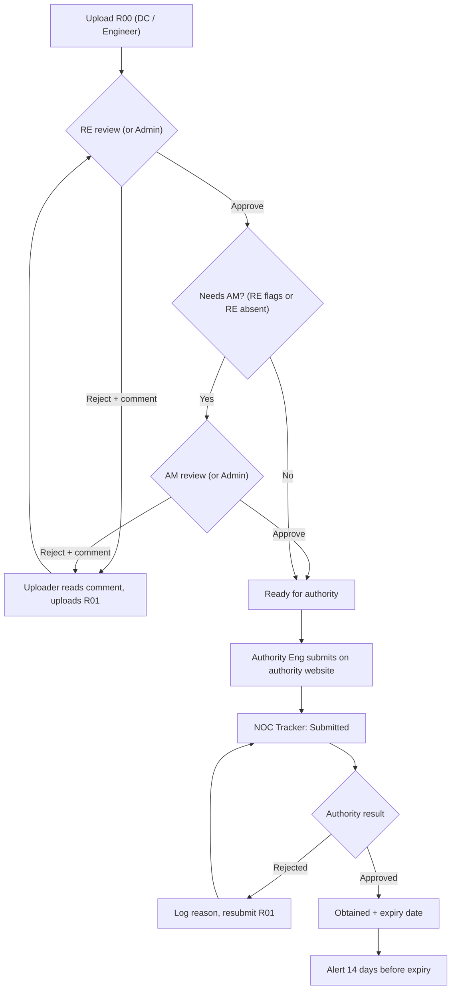
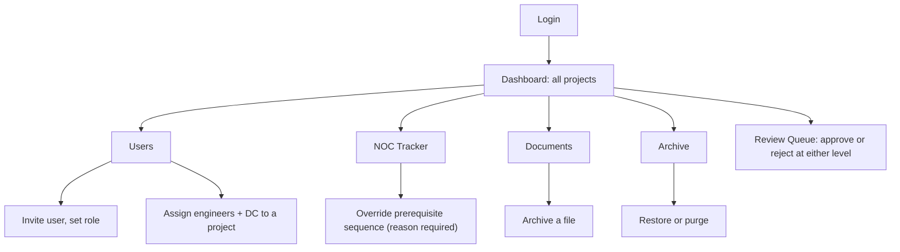
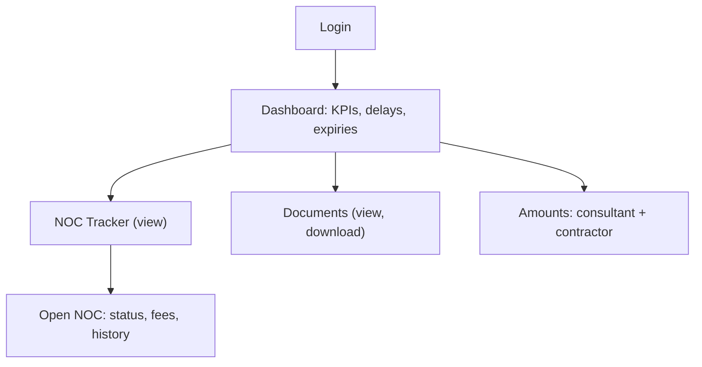
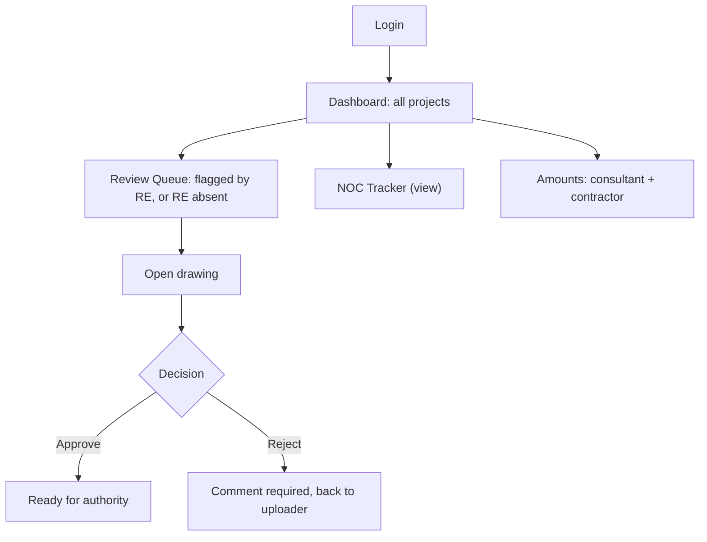
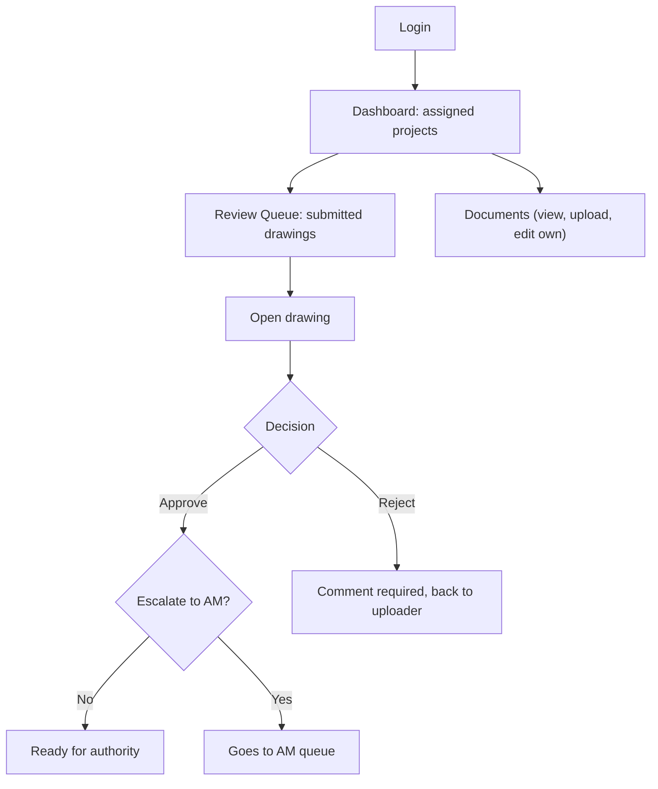
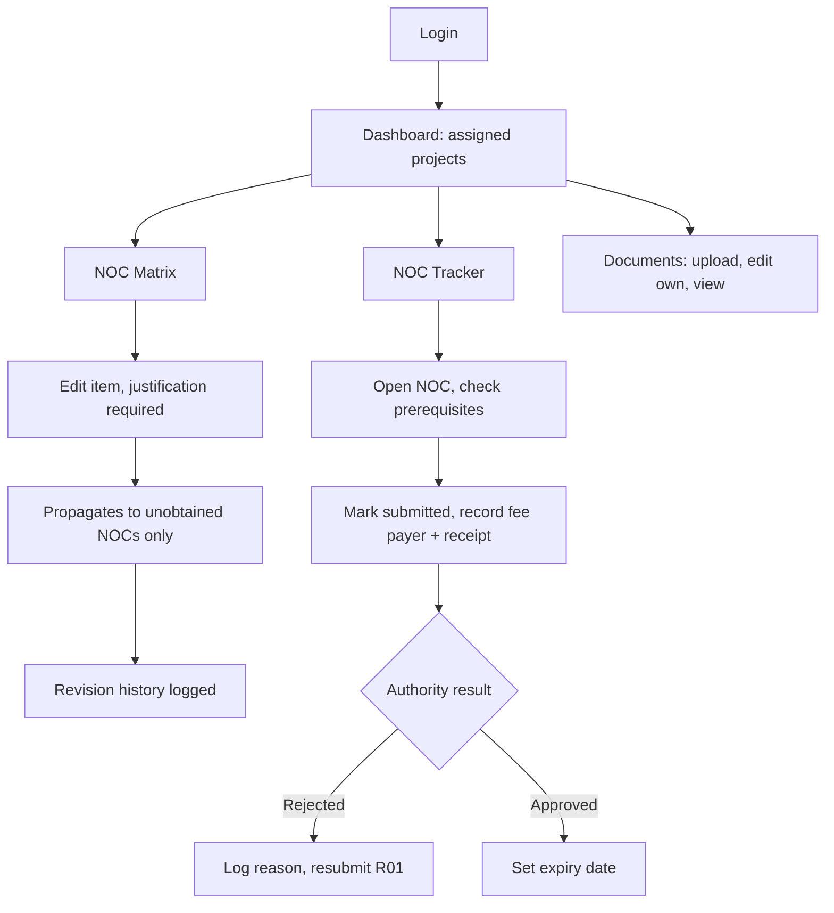
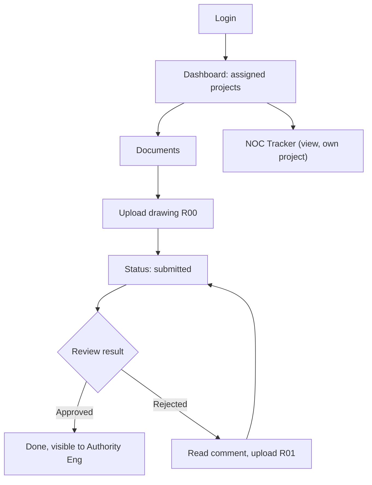
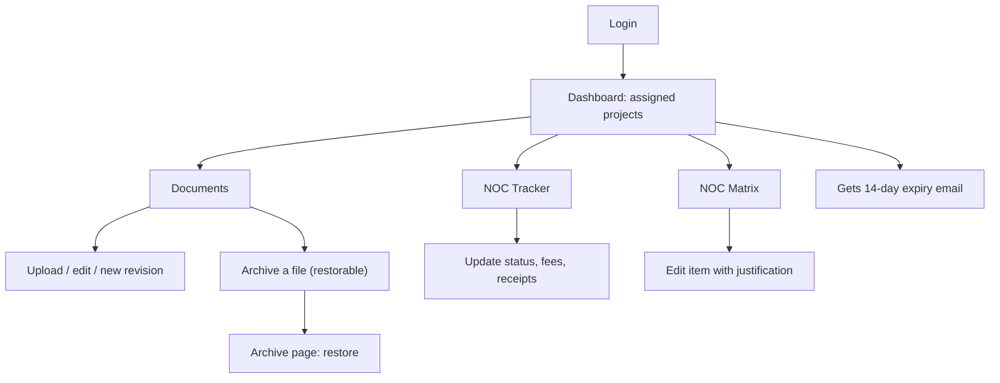

# CVTEC EDMS – Role Flows

Baseline of the intended workflow, built from Jaylene's answers. Use it to test the app against. Updated 14 Oct 2026 with her answers to questions 1–6. **?** = not yet confirmed.

## 1. Who can do what

✓ allowed · — not allowed · ? open question. "Assigned" = only projects the user is assigned to.

| Capability                          | Admin          | CEO             | AM                       | RE       | Auth Eng    | Engineer      | DC             |
| ----------------------------------- | -------------- | --------------- | ------------------------ | -------- | ----------- | ------------- | -------------- |
| Project scope                       | All            | All (read-only) | All                      | Assigned | Assigned    | Assigned      | Assigned       |
| View documents and NOCs             | ✓              | ✓               | ✓                        | ✓        | ✓           | ✓             | ✓              |
| Upload documents                    | ✓              | —               | —                        | x        | ✓           | ✓             | ✓              |
| Edit / new revision                 | ✓              | —               | —                        | x        | ✓ own files | x (inform DC) | ✓ any in scope |
| Delete (archive, restorable)        | ✓              | —               | —                        | —        | —           | —             | ✓              |
| Approve drawings                    | ✓ either level | —               | ✓ if flagged / RE absent | ✓ first  | —           | —             | —              |
| Edit NOC Matrix                     | ✓              | —               | —                        | —        | ✓           | —             | ✓              |
| Update NOC tracker (status, fees)   | ✓              | —               | —                        | —        | ✓           | —             | ✓              |
| Override NOC sequence (with reason) | ✓              | —               | —                        | —        | —           | —             | —              |
| See client–consultant amount        | ✓              | ✓               | ✓                        | —        | —           | —             | —              |
| See client–contractor amount        | ✓              | ✓               | ✓                        | ✓        | ✓           | ✓             | ✓              |
| Manage users, roles, assignments    | ✓              | —               | —                        | —        | —           | —             | —              |
| Expiry email (14 days before)       | —              | —               | —                        | —        | ✓           | ✓             | ✓              |

## 2. Document and NOC lifecycle (all roles)

## 3. Flow per role

### Admin

Lands on: Dashboard (all projects). Nav: Dashboard, NOC Tracker, NOC Matrix, Documents, Review, Users, Archive.

Create: users, assignmentsDelete: archive / purgeOverride with reasonUpload, edit, approve (either level). Edit NOC MatrixOnly Admin registers projects

### CEO

Lands on: Dashboard (read-only). Nav: Dashboard, NOC Tracker, Documents.

View everything in scope. No create / edit / delete / approveSees all projects, read-only

### Area Manager (AM)

Lands on: Dashboard (all projects). Nav: Dashboard, NOC Tracker, Documents, Review Queue.

Approve / reject (second level). No upload, no deleteNo NOC fee recording

### Resident Engineer (RE)

Lands on: Dashboard (assigned projects). Nav: Dashboard, Documents, Review Queue.

Approve / reject (first level), No delete, no consultant amountUpload; edit own uploads

### Authority Engineer

Lands on: Dashboard (assigned projects). Nav: Dashboard, NOC Tracker, NOC Matrix, Documents.

Edit matrix + trackerUpload + edit ownNo approve drawings, no delete, no sequence override

### Engineer (MEP / Architect / Structure / Civil)

Lands on: Dashboard (assigned projects). Nav: Dashboard, Documents. Discipline is set per project assignment.

Upload only (R00, R01); for adjustments inform DC. No delete, no approve, no consultant amount.

### Document Controller (DC)

Lands on: Dashboard (assigned projects). Nav: Dashboard, NOC Tracker, NOC Matrix, Documents, Archive.

Create / update / archive in own projects. No Users page, no approving drawings, no other projects.

## 4. Answered by Jaylene (14-15 Oct 2026)

1. Client and contractor staff never log in. They only receive emails from the system.
2. Admin can approve drawings and edit the NOC Matrix.
3. Engineers cannot edit or replace their own uploads (they only upload; for adjustments they must inform the DC).
4. The CEO sees all projects, read-only.
5. CVTEC uses 3 stages: Pre-Construction (Information and Design), Construction, Handover.
6. Only Admin registers new projects.
7. Authority Engineer can upload and edit own files. RE cannot upload or edit. Engineers upload only.
8. AM cannot record NOC fees. Only Authority Engineer, Document Controller and Admin can.

## 5. Still open

1. Client and contractor emails: she has no answer yet. Nothing gets built until she confirms which events trigger an email to each party and who sets their contact emails.
