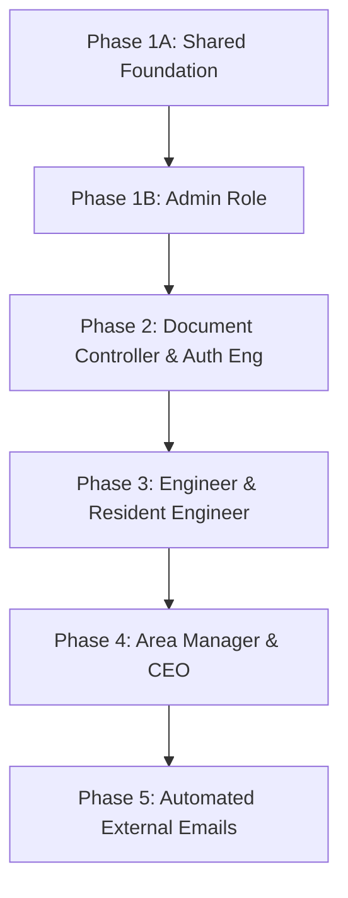

# CVTEC EDMS – Phase 1: Shared Foundation & Admin Role Implementation Plan

**Target**: Shared Foundation (`00-foundation.md`) + Admin Role (`01-admin.md`)  
**Status**: Pending Review  
**Date**: 2026-10-14

---

## 1. Goal Description

Establish the shared security and authorization foundation (`F1`–`F10`) and implement the **Admin** role end-to-end.

Without the shared foundation, no individual role can be secured or tested at the database level. Without the Admin role, no projects, user invitations, discipline assignments, or sequence overrides can be created for subsequent roles to operate against.

---

## 2. User Review Required

> [!IMPORTANT]
> **Privilege Escalation Fix**: Currently, `lib/auth.ts` falls back to `user.user_metadata?.role` when a profile row is missing. Because Supabase Auth users can edit their own metadata, this allows arbitrary role escalation. The foundation will create a database trigger on `auth.users` to insert a `profiles` row on creation and make the fallback deny access.

> [!IMPORTANT]
> **Financial Confidentiality Isolation**: Consultant amounts will be migrated out of `projects` into an isolated `project_confidential` table with strict RLS restricted to `admin`, `ceo`, and `area_manager`.

> [!WARNING]
> **Role Enum Cleanup**: Legacy roles (`doc_controller`, `manager`) in `profiles` and code will be normalized to `dc` and `area_manager`. Dead discipline roles will be removed from system roles and stored on `project_members.discipline`.

---

## 3. Implementation Order & Strategy



### Why Foundation First?

- Generates `private.has_role()` and `private.can_see_project()` RLS functions.
- Creates `document_reviews` check constraints and `audit_log` table.
- Enforces strict dual-layer authorization (`requireCan` in actions, RLS in Postgres).
- Seeds 7 test accounts (1 per role) and 2 test projects.

### Why Admin First Among Roles?

- Admin provisions the users and assigns their roles.
- Admin registers new projects (`/projects/new`) with contract sums and contact emails.
- Admin assigns staff and engineering disciplines (`mep`, `architect`, `structure`, `civil`) to projects.
- Without Admin, other roles have no assigned projects or seeded permissions to test.

---

## 4. Proposed Changes

### Component 1: Database Foundation & Migrations (`supabase/migrations/`)

#### [NEW] `supabase/migrations/20261014000000_shared_foundation.sql`

- **Role Enum Migration**: Normalize roles to `admin`, `ceo`, `area_manager`, `resident_engineer`, `authority_engineer`, `engineer`, `dc`.
- **Profiles Trigger**:
  ```sql
  create or replace function public.handle_new_user()
  returns trigger
  security definer set search_path = ''
  language plpgsql as $$
  begin
    insert into public.profiles (id, email, full_name, role, created_at, updated_at)
    values (
      new.id,
      new.email,
      coalesce(new.raw_user_meta_data->>'full_name', split_part(new.email, '@', 1)),
      coalesce(new.raw_user_meta_data->>'role', 'engineer')::public.app_role,
      now(),
      now()
    )
    on conflict (id) do nothing;
    return new;
  end;
  $$;
  ```
- **Security Definer RLS Helpers**:
  - `private.has_role(allowed_roles text[])`
  - `private.can_see_project(target_project_id uuid)`
- **Financial Confidentiality Table**:
  - `public.project_confidential (project_id uuid primary key, client_consultant_amount numeric(14,2))`
  - RLS: SELECT only for `admin`, `ceo`, `area_manager`.
- **Document Review State Machine**:
  - `public.document_reviews`: records level (`re`, `am`, `admin`), decision (`approve`, `reject`), comment.
  - Constraint: `decision != 'reject' or (comment is not null and length(trim(comment)) > 0)`.
- **Soft Delete & Audit Log**:
  - `documents.archived_at` and `documents.archived_by`.
  - `public.audit_log` table with triggers on documents, NOCs, and member assignments.
- **Seeded Test Accounts & Projects**:
  - 1 user per role at test domain `@cvtec.test`.
  - Project 23015 and Project 23016 with distinct assignments.

---

### Component 2: Auth & Permissions Layer (`lib/`)

#### [MODIFY] `lib/auth.ts`

- Import `AppRole`, `Capability`, `can`, `canEditDocument`, `navFor` from `@/lib/permissions`.
- Replace legacy `Role` type with `AppRole`.
- Add `requireCan(capability: Capability)`:
  ```typescript
  export async function requireCan(capability: Capability) {
    const user = await requireUser();
    if (!can(user.role, capability)) {
      throw new Error(
        `Unauthorized: Role '${user.role}' lacks capability '${capability}'`,
      );
    }
    return user;
  }
  ```
- Deny access if `profiles` row is missing; remove fallback to `user_metadata.role`.

#### [MODIFY] `components/layout/app-header.tsx`

- Replace hardcoded navigation links with dynamic items returned by `navFor(currentUser.role)`.
- Display role indicator pill with normalized badge styling.

---

### Component 3: Admin Module (`app/(app)/users`, `app/actions/admin.ts`, `app/(app)/projects`)

#### [NEW] `app/actions/admin.ts`

- `inviteUser(email: string, role: AppRole)`: uses service-role client `lib/supabase/admin.ts`.
- `updateUserRole(userId: string, newRole: AppRole)`:
  - Guard: blocks demoting the last active Admin.
  - Guard: blocks self-demotion.
- `deactivateUser(userId: string)`.
- `createProject(input: CreateProjectInput)`: registers stage (`pre_construction`, `construction`, `handover`), contact emails, and both contract amounts.
- `updateProjectMembers(projectId: string, members: MemberAssignment[])`: assigns staff and discipline (`mep`, `architect`, `structure`, `civil`).
- `overrideNocSequence(nocId: string, reason: string)`: validates reason, writes to `audit_log`, sets override flag.
- `purgeDocument(docId: string)`: hard deletes storage blob and database row with audit log entry.

#### [MODIFY] `app/(app)/users/page.tsx`

- Render user list with status, role selector, invite modal.
- Disable role demotion for last remaining admin and current logged-in user.

#### [NEW] `app/(app)/projects/new/page.tsx`

- Form for Admin project registration with validation.

#### [MODIFY] `app/(app)/archive/page.tsx`

- Add Admin-only "Purge" button with typed confirmation modal ("CONFIRM PURGE").

---

## 5. Verification Plan

### Automated Verification

1. **Database Migration Dry-Run**:
   - Run SQL migration in test environment.
   - Verify triggers and functions:
     ```sql
     select private.has_role(array['admin']);
     ```
2. **TypeScript & Build Verification**:
   - `npx tsc --noEmit` -> ensure 0 errors.
   - `pnpm run build` -> ensure all routes compile cleanly.

### Manual Verification Matrix

| Test Case     | Actor     | Action                                           | Expected Result                                                   |
| ------------- | --------- | ------------------------------------------------ | ----------------------------------------------------------------- |
| **TC-FND-01** | Non-Admin | Call `inviteUser` or direct insert to `profiles` | 403 Forbidden                                                     |
| **TC-FND-02** | Engineer  | Query `project_confidential` via Supabase client | Empty result set (0 rows)                                         |
| **TC-ADM-01** | Admin     | Invite new user `dc1@cvtec.test` as `dc`         | Profile row created with role `dc`                                |
| **TC-ADM-02** | Admin     | Register new project at `/projects/new`          | Project created; confidential amount in `project_confidential`    |
| **TC-ADM-03** | Admin     | Assign Engineer with discipline `mep`            | Stored in `project_members.discipline`                            |
| **TC-ADM-04** | Admin     | Demote sole admin account                        | Rejected with error: "Cannot demote last admin"                   |
| **TC-ADM-05** | Admin     | Override blocked NOC sequence without reason     | Validation fails; with reason -> succeeds and logs to `audit_log` |
| **TC-ADM-06** | Admin     | Purge archived document                          | Blob removed from bucket, row removed from `documents`            |
