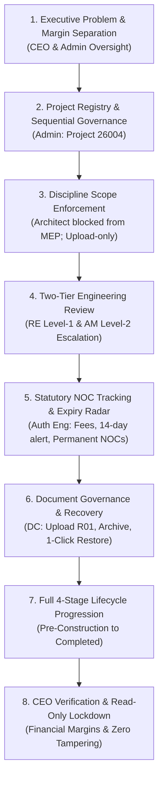

# CVTEC EDMS – Manual Click-by-Click MVP Presentation Guide

> **Document Path**: `docs/manual-mvp-workflow.md`  
> **Target Audience**: Presenter, Evaluator, Demo Lead, Client Evaluator (Ma'am Jaylene)  
> **Test Project Code**: `26004` (or any fresh sequential 5-digit number, e.g., `26005`)  
> **Baseline Reference**: [CVTEC_EDMS.md](file:///D:/giomj/Projects/engineer-docs-collab/CVTEC_EDMS.md)  
> **Simulated System Date**: **22 Oct 2026**  
> **Universal Test Password**: `cvtec123`

---

## 1. Executive Presentation Strategy & Priority Order

When presenting the MVP to Ma'am Jaylene, prioritize business control, compliance confidence, and commercial security before walking through operational mechanics.



### Why This Order Matters to the Client

1. **Financial and Legal Protection First**: Proves confidential consultant fees (`AED 1,800,000`) are strictly concealed from site engineers and contractors, eliminating leaks.
2. **Elimination of Folder Chaos**: Shows automated project numbering (`#26004`) replacing ad-hoc Windows/SharePoint folder creation.
3. **Strict Accountability**: Shows engineers cannot tamper with files once submitted; only Document Controllers handle revisions and archiving.
4. **Statutory Risk Elimination**: Demonstrates automatic 14-day alerts before municipal permits expire, preventing costly site stop-work orders while filtering out permanent clearances to prevent alert fatigue.

---

## 2. Business Rules & Jaylene Decision Matrix

Every feature in the MVP maps directly to verified business requirements from Ma'am Jaylene (`CVTEC_EDMS.md`):

| Rule        | Baseline Requirement                                                          | MVP Implementation & Enforcement                                                                                                                                                                       | Presenter Talking Point                                                                                                                       |
| :---------- | :---------------------------------------------------------------------------- | :----------------------------------------------------------------------------------------------------------------------------------------------------------------------------------------------------- | :-------------------------------------------------------------------------------------------------------------------------------------------- |
| **Rule #1** | Client and contractor staff never log in.                                     | No external login accounts; client and contractor email fields exist strictly for transmittal notifications.                                                                                           | _"External developers and contractors never enter our internal EDMS. They receive verified email notifications and formal transmittals."_     |
| **Rule #2** | Admin can approve drawings and edit NOC Matrix.                               | Admin possesses universal permissions across [`lib/permissions.ts`](file:///D:/giomj/Projects/engineer-docs-collab/lib/permissions.ts), including drawing review and sequence override.                | _"The Admin serves as the operational safety valve, able to clear bottlenecks or adjust statutory matrices when authorities update rules."_   |
| **Rule #3** | Engineers cannot edit or delete their uploads.                                | Discipline Engineers have `document.upload` only; `document.edit` and `document.archive` are restricted to Document Controllers.                                                                       | _"Drawings are official records. Once Liam uploads R00, he cannot silently overwrite it. Any correction requires formal DC revision R01."_    |
| **Rule #4** | CEO sees all projects in read-only mode.                                      | CEO dashboard provides global KPIs, financials, and NOC radars with zero creation, editing, or approval buttons.                                                                                       | _"Executive leadership gets complete visibility into delays, margins, and permit health without any risk of accidental operational edits."_   |
| **Rule #5** | CVTEC lifecycle stages (Pre-Construction, Construction, Handover, Completed). | 4-stage lifecycle engine with automated stage gate prerequisites and readiness recalculation in [`lib/project-lifecycle.ts`](file:///D:/giomj/Projects/engineer-docs-collab/lib/project-lifecycle.ts). | _"Projects cannot advance blindly. Every stage requires verified technical approvals, specialist studies, and statutory NOCs."_               |
| **Rule #6** | Only Admin registers new projects.                                            | `project.create` capability is locked strictly to `admin` in [`lib/permissions.ts`](file:///D:/giomj/Projects/engineer-docs-collab/lib/permissions.ts).                                                | _"Centralized registration prevents duplicate project codes and guarantees uniform consultant team staffing from day one."_                   |
| **Rule #7** | Two-tier review hierarchy; RE cannot see consultant fee.                      | RE executes Level-1 technical review; flags high-risk drawings to AM; `amount.consultant.view` is hidden from RE.                                                                                      | _"Site engineers focus purely on technical compliance. Commercial consultancy agreements remain confidential between management and client."_ |
| **Rule #8** | Strict fee recording roles.                                                   | Only Authority Engineer, Document Controller, and Admin can record NOC fee receipts; Area Manager is view-only for fees.                                                                               | _"Financial fee accounting is restricted to permitting specialists and controllers to prevent unauthorized payment logging."_                 |
| **Radar**   | Smart Statutory Expiry Radar.                                                 | Permits expiring within 14 days trigger amber warnings; permanent clearances and completed projects are excluded.                                                                                      | _"Engineers never suffer alert fatigue. Permanent permits like Concept Approval never trigger false renewal alarms."_                         |

---

## 3. Architecture, Authentication & Data Flow

### A. Authentication & Role Permissions

- **Auth Engine**: Supabase Auth with secure HTTP-only cookies managed via [`@supabase/ssr`](file:///D:/giomj/Projects/engineer-docs-collab/package.json#L15) and [`lib/auth.ts`](file:///D:/giomj/Projects/engineer-docs-collab/lib/auth.ts).
- **Canonical Roles**: `admin`, `ceo`, `area_manager`, `resident_engineer`, `authority_engineer`, `engineer`, `dc`.
- **Discipline Matching**: Server actions verify the user's assigned discipline (`architect`, `structure`, `mep`, `civil`) against the target submittal scope.

### B. Subsystem Data Flows (Input, Process, Output)

```text
1. Project Registration
   - Input: Project Code (#26004), Master Authority, Contract Sums, Contract Dates, 8 Assigned Team Staff.
   - Process: Server action createProjectAction (app/actions/admin.ts) inserts records into projects, project_members, and project_confidential.
   - Output: Initialized project workspace at /projects/[code] with bound discipline permissions.

2. Discipline Drawing Submission
   - Input: PDF/DWG file, Document Number (26004-ARC-001), Title, Discipline, Revision (R00).
   - Process: Server action uploadDocumentAction (app/actions/documents.ts) verifies canUploadDiscipline, writes bytes to Supabase storage documents bucket, inserts row into documents table.
   - Output: Listed drawing row in /documents with status 'submitted'; triggers entry in RE Review Queue.

3. Two-Tier Engineering Review
   - Input: Review decision (Approve Direct / Escalate to AM / Reject with Comments).
   - Process: Server action reviewDocumentAction (app/actions/reviews.ts) updates document status; logs review note and reviewer identity in document_reviews table.
   - Output: Status becomes 'ready_for_authority', routes to AM queue, or returns to uploader as rejected for R01.

4. Statutory Permitting & Fee Tracking
   - Input: Authority Tracking Ref, Fee Amount (AED 12,000), Payer, Receipt Number, Expiry Date or Permanent Flag.
   - Process: Server action updateNocStatusAction (app/actions/noc.ts) records receipt in project_nocs; calculates validity window against baseline date (2026-10-22).
   - Output: Green 'Paid' receipt badge; Amber 'Expiring in 14 Days' alert or Green 'Permanent' badge; updates CEO radar.

5. Stage Gate Prerequisite Engine
   - Input: Milestone dates, uploaded specialist studies (Soil, Topo), approved authority NOCs.
   - Process: evaluateStageGateReadiness (lib/project-lifecycle.ts) verifies mandatory prerequisites; advanceProjectStageAction (app/actions/admin.ts) updates projects.lifecycle_stage.
   - Output: Stage stepper advances; unlocks next phase operational scope; Completed stage archives site radars.

6. Governance, Archive & Recovery
   - Input: Document Controller clicks Archive Document on row 26004-ARC-099.
   - Process: archiveDocumentAction (app/actions/documents.ts) sets archived_at timestamp; restoreDocumentAction resets timestamp to null.
   - Output: File is unlisted from active /documents; instantly recoverable via 1-click restore in /archive with full audit history.
```

---

## 4. Nearest Dates & Sample Data Cheat Sheet

All dates align with `CVTEC_EDMS.md` (Oct 14–22, 2026 baseline):

| Field in Drawer / Form                | Date to Type | Purpose in Demo                                             |
| :------------------------------------ | :----------- | :---------------------------------------------------------- |
| **Design Contract Commencement**      | `2026-10-14` | Registration form: Design phase contract start              |
| **Design Contract Completion**        | `2026-10-21` | Registration form: Design contract delivery deadline        |
| **Supervision Contract Commencement** | `2026-10-22` | Registration form: Supervision contract start date          |
| **Supervision Contract Target**       | `2026-11-30` | Registration form: Supervision target completion            |
| **Kick-off Date**                     | `2026-10-14` | Milestone drawer: Matches Jaylene's baseline date           |
| **Survey Completion**                 | `2026-10-16` | Milestone drawer: Topographical baseline                    |
| **Concept Approval**                  | `2026-10-18` | Milestone drawer: Satisfies `gate-concept`                  |
| **Design Commencement**               | `2026-10-19` | Milestone drawer: Design phase start                        |
| **Planned Completion**                | `2026-10-21` | Milestone drawer: Design completion                         |
| **Building Permit Issuance**          | `2026-10-22` | Milestone drawer: Satisfies `gate-permit` (Simulated Today) |
| **Site Commencement**                 | `2026-10-22` | Milestone drawer: Construction start date                   |
| **Target Substantial Completion**     | `2026-11-15` | Milestone drawer: Construction target milestone             |
| **Testing & Commissioning**           | `2026-11-20` | Milestone drawer: Handover milestone                        |
| **Civil Defence Inspection**          | `2026-11-25` | Milestone drawer: Handover milestone                        |
| **BCC Issuance Date**                 | `2026-11-30` | Milestone drawer: Building Completion Certificate           |
| **NOC Expiry Date (DEWA/RTA)**        | `2026-11-04` | **13 days from today $\rightarrow$ Triggers 14-day alert!** |

---

## 5. Global Productivity & Command Deck Features

Before starting the project lifecycle demo, showcase the high-productivity shell features:

- **Global Command Palette (`Ctrl + K` or `Cmd + K`)**:
  - Press `Ctrl + K` anywhere in the app to open the quick command modal.
  - Search any accessible route, switch light/dark/system themes, or trigger **Register New Project**.
- **Collapsible Sidebar Rail (`Ctrl + B` or `Cmd + B`)**:
  - Press `Ctrl + B` or click the collapse button in the bottom left or top header to toggle between the 260px expanded menu and the 72px icon rail.
- **Header Utility Deck**:
  - Quick Search bar with shortcut indicator.
  - Notifications popover with real-time indicator dot for upcoming expiries and submittals.
  - User Profile popover showing name, email, system role, and 1-click sign out.

---

## 6. Step-by-Step Manual Click Guide & Presenter Script

### Step 1: Register New Project Manually

- **Login as**: `admin@test.com` (System Administrator)
- **Password**: `cvtec123`
- **URL**: [localhost:3000/projects/new](http://localhost:3000/projects/new) (or open via `Ctrl+K` $\rightarrow$ **Register New Project**)

#### Phase 1: Scope, Commercials & Contract Schedules

1. **Project Code**:
   - Notice the code is auto-populated with the next sequential code, or click the **Auto-Generate** (`#` icon) button.
   - Observe the real-time code availability indicator in green: `Next available sequential code: #26004` (or type `26004` to see `Code #26004 is available`).
2. **Master Authority**: Select `Nakheel and Trakhees` (or `DEWA` / `Dubai Municipality`).
3. **Initial Stage**: Select `Pre-Construction (Design)` (options: `Planning`, `Pre-Construction (Design)`, `Construction`, `Handover`, `Completed`).
4. **Project Name / Description**: Type `Creek Marina Pavilion`.
5. **Client Name**: Type `Emaar Properties PJSC`.
6. **Contractor Name**: Type `Al Futtaim Construction`.
7. **Client Notification Emails**: Type `pm@emaar.ae, director@emaar.ae` (comma-separated validation).
8. **Contractor Notification Emails**: Type `project@alfuttaim.com`.
9. **Client–Contractor Contract Sum (AED)**: Type `25000000` (AED 25,000,000).
10. **Client–Consultant Sum (AED) [Confidential]**: Type `1800000` (AED 1,800,000).
    - _Presenter Talking Point_: _"Notice this field is explicitly tagged as Confidential. It is saved to a restricted database table accessible only to Admin, CEO, and Area Manager. Site engineers will never see this number."_
11. **Contract Schedules & Target Dates**:
    - **Design Contract**: Commencement `2026-10-14`, Completion `2026-10-21`.
    - **Supervision Contract**: Commencement `2026-10-22`, Target Completion `2026-11-30`.
12. Click **Next: Assign Team $\rightarrow$** (bottom right).

#### Phase 2: Consultant Team Staffing

1. **Searchable Staff Popover**:
   - Each slot features a searchable popover grouping users into **Suggested for this role** (matching system roles first) and **Other staff**.
2. **Management & Permitting Oversight**:
   - **Resident Engineer (RE)**: Select `Resident Engineer Lead (re@test.com)`.
   - **Area Manager (AM)**: Select `Hassan Al-Maktoum (am3@test.com)`.
   - **Authority Engineer**: Select `Zayed Al-Hashimi (ae3@test.com)`.
   - **Document Controller (DC)**: Select `Principal Document Controller (dc@test.com)`.
3. **Multidisciplinary Engineering Leads**:
   - **Architectural Lead**: Select `Liam Thorne (architect@test.com)`.
   - **Structural Lead**: Select `David Chen (structural@test.com)`.
   - **MEP Lead**: Select `Omar Farooq (mep@test.com)`.
   - **Civil Lead**: Select `Aisha Al-Nuaimi (civil@test.com)`.
4. Click button **Register Project (8 Assigned)**.
   - _Outcome_: Toast confirms `Project 26004 created with 8 team members.` You are redirected directly to the interactive project view at `/projects/26004`.
   - _Presenter Talking Point_: _"In one single workflow, we have bound all 8 key engineering roles to this project. Security permissions are automatically configured."_

---

### Step 2: Post-Registration Projects Workspace & Dynamic Team Management

- **Login as**: `admin@test.com`
- **URL**: [localhost:3000/projects](http://localhost:3000/projects)

1. Locate project **26004** in the Projects directory.
2. **Manage Team Anytime**:
   - Click button **Manage Team** on the project card.
   - The `ProjectTeamDialog` opens, showing the 4 oversight roles and 4 discipline leads with their assigned team members.
   - Adjust any member or add unassigned disciplines without recreating the project.
   - Click **Save Team Assignments**.
3. **View Documents**:
   - Click button **View Documents** to open the `ProjectDocumentsView` modal.
   - View deliverables and test programmatic file downloads.
4. Click **NOC Tracker** button to transition directly into `/noc-tracker/26004`.

---

### Step 3: Milestone Baseline Setup & Custom Gate Prerequisites

- **Login as**: `admin@test.com`, `am3@test.com`, or `re@test.com`
- **URL**: [localhost:3000/noc-tracker/26004](http://localhost:3000/noc-tracker/26004)

1. Select Project **26004** from the top project picker.
2. In the top right header, click **Inspect Gate Checklist**.
3. The `StageGateDrawer` opens on the right.
4. **Enter Baseline Milestone Dates**:
   - Under **Milestone Dates Reference**, click **Edit Dates** (top right of section).
   - Enter the baseline dates:
     - **Kickoff**: `2026-10-14`
     - **Survey Completion**: `2026-10-16`
     - **Concept Approval**: `2026-10-18`
     - **Design Commencement**: `2026-10-19`
     - **Planned Completion**: `2026-10-21`
     - **Building Permit**: `2026-10-22`
     - **Site Commencement**: `2026-10-22`
     - **Target Substantial Completion**: `2026-11-15`
   - Click **Save Milestone Dates**.
   - _Outcome_: Checklist recalculates immediately. `gate-concept` and `gate-permit` update to green `Satisfied` badges.
5. **Custom Stage Gate Prerequisites**:
   - In the drawer, click button **+ Add Gate**.
   - Title: `Client Special Aesthetic Clearance`.
   - Category: Select `Discipline Technical Approval`.
   - Check **Mandatory for Stage Advancement**.
   - Action Hint: `Obtain written sign-off from Client Project Director`.
   - Click **Save Gate Prerequisite**.
   - _Outcome_: Custom prerequisite attaches to the stage gate checklist with an interactive toggle switch and delete button for authorized managers.
   - _Presenter Talking Point_: _"Every project has unique client requirements. The system allows adding mandatory stage gates on the fly without database migrations."_

---

### Step 4: Operational Discipline Progress & Specialist Clearances (/noc-tracker vs /dashboard)

- **Dedicated Operational Workspace**: [localhost:3000/noc-tracker/26004](http://localhost:3000/noc-tracker/26004)
- **Executive Read-Only Overview**: [localhost:3000/dashboard](http://localhost:3000/dashboard)

1. **Operational Separation**:
   - Point out that `/dashboard` is purely read-only analytics to prevent accidental changes.
   - Operational file uploads and discipline status updates occur strictly inside `/noc-tracker/[projectID]`.
2. **Specialist Studies Submittal, Review & Revision Workflow**:
   - In the **Third-Party Specialist Studies** card on `/noc-tracker/26004`, locate **Geotechnical Soil Investigation**.
   - Click **Attach Report** to open the native device file picker. Select any sample PDF (e.g., `borehole-report.pdf`).
   - Notice the system dynamically calculates the exact file size and displays the real file name.
3. **Technical Review & Approval**:
   - Logged in as `re@test.com` or `admin@test.com`, click **Approve** on the uploaded study.
   - Status changes to green badge **Approved Study**.
   - _Outcome_: Re-open **Inspect Gate Checklist**; observe that `gate-geotech` is now 100% **Satisfied**!

---

### Step 5: Discipline Engineer Drawing Upload & Scope Enforcement

- **Login as**: `architect@test.com` (Liam Thorne – Architectural Lead)
- **Password**: `cvtec123`
- **URL**: [localhost:3000/documents](http://localhost:3000/documents)

1. Click button **+ Upload Document** (top right).
2. **Discipline Ownership Enforcement Test**:
   - In the modal, select Project: `26004 - Creek Marina Pavilion`.
   - Set Discipline to: `MEP` (deliberate mismatch).
   - Document Number: `26004-MEP-001`.
   - Title: `HVAC Schematic`.
   - Attach any sample file and click **Upload & Submit**.
   - _Outcome_: The server action rejects the submittal with:  
     `Upload rejected: Engineers can only upload drawings for their assigned discipline (ARCHITECT).`
   - _Presenter Talking Point_: _"Ma'am Jaylene, notice that even if an architect accidentally tries to submit MEP drawings, the system blocks it on the server. Scope discipline integrity is strictly guaranteed."_
3. **Correct Architectural Upload**:
   - Switch Discipline to: `Architectural`.
   - Document Number: `26004-ARC-001`.
   - Title: `Pavilion Concept Layout & Elevations`.
   - Revision: `R00`.
   - Attach file $\rightarrow$ Click **Upload & Submit**.
   - _Outcome_: Drawing appears in the documents list with a blue **Submitted** badge.
4. **Demonstrate Upload-Only Guardrail (Jaylene Rule #3)**:
   - Point out that Liam **cannot edit or delete** his upload.
   - _Presenter Talking Point_: _"Per CVTEC policy, engineers upload drawings but cannot alter or delete them. If Liam made a mistake, he must notify the Document Controller to upload revision R01."_

---

### Step 6: Resident Engineer Level-1 Technical Review

- **Login as**: `re@test.com` (Resident Engineer Lead)
- **Password**: `cvtec123`
- **URL**: [localhost:3000/review](http://localhost:3000/review)

1. In the Review Queue, filter or locate `26004-ARC-001`.
2. Click **Review** on the row.
3. The `DrawingReviewModal` opens:
   - Point out the 3 decision pathways:
     - `Reject + Comment`: Demands remarks and routes back to Liam for `R01`.
     - `Escalate to Area Manager`: Flags drawing for managerial second-level review (e.g., major design deviation).
     - `Approve (Direct)`: Standard Level-1 technical sign-off.
4. Click **Approve (Direct)**.
5. _Outcome_: Drawing status updates to green badge **Ready for Authority**. Submittal clears from the pending review queue.

---

### Step 7: Authority Engineer Permitting, Permanent Clearances & Expiry Radar

- **Login as**: `ae3@test.com` (Zayed Al-Hashimi – Authority Engineer)
- **Password**: `cvtec123`
- **URL**: [localhost:3000/noc-tracker/26004](http://localhost:3000/noc-tracker/26004)

1. Select Project **26004**.
2. Click on the first NOC row: `DEWA Substation & Electrical Load NOC`.
3. **Statutory Requirements & Custom Deliverables**:
   - Under **Statutory Checklist Requirements**, verify items are satisfied.
   - Point out the **+ Add Requirement** input to add custom project deliverables.
   - Click button **Submit Application**.
   - Input Authority Tracking Ref: `DEWA-2026-004`, Date: `2026-10-22`.
   - Click **Confirm Submission**. Status changes to **Submitted** (`applied`).
4. **Authority Fee Settlement (Jaylene Rule #8)**:
   - In Drawer, scroll to **Record Fee Payment**:
   - Payer: Select `Contractor` (or `Consultant Advance` / `Client`).
   - Amount: `12000`.
   - Receipt Number: `RCP-DEWA-004`.
   - Click **Record Payment**. Green `Paid` badge displays with payer classification.
   - _Presenter Talking Point_: _"Notice that only the Authority Engineer, Document Controller, or Admin can record fee receipts. This prevents untracked municipal cash advances."_
5. **Authority Decision Recording: Temporary vs Permanent Clearances**:
   - Click button **Record Decision**:
   - **Scenario A: Temporary Permit (14-Day Expiry Radar)**:
     - Decision: `Approved / Obtained`.
     - Certificate Ref: `CERT-DEWA-004`.
     - Expiry Date: **`2026-11-04`** (13 days from simulated date 22 Oct 2026).
     - Click **Confirm Obtained**. NOC status updates to **Approved**.
     - _Outcome_: Amber `Expiring in 14 Days` badge displays in the alert banner and CEO radar.
   - **Scenario B: Permanent Milestone Clearance (Zero False Alarms)**:
     - Click **Update Validity** on the approved NOC.
     - Check the checkbox: **Permanent Clearance / Milestone NOC**.
     - Notice the Expiry Date field clears and disables with helper text: `This clearance is permanent and will not trigger renewal alerts.`
     - Click **Confirm Obtained**.
     - _Outcome_: Table displays green **Permanent** badge in Expiry Date column. No false alerts generated!
6. **Dispatched Drawing Resubmission Flow**:
   - If an authority rejects or requires modifications, the drawer unlocks **Resubmit Rejected Drawings**.
   - Enter revised file name (`DWG-26004-DCD-R01.pdf`) and click **Confirm & Dispatch**.
   - Submittal resets to **Submitted** (`applied`) as revision `R01`.

---

### Step 8: Document Controller Governance & 1-Click Restore

- **Login as**: `dc@test.com` (Principal Document Controller)
- **Password**: `cvtec123`
- **URL**: [localhost:3000/documents](http://localhost:3000/documents)

1. Select Project `26004`.
2. Click **+ Upload Document**:
   - Doc Number: `26004-ARC-099`.
   - Title: `Superseded Concept Sketch`.
   - Revision: `R00`.
   - Attach file $\rightarrow$ Click **Upload & Submit**.
3. **Archive Document**:
   - On row `26004-ARC-099`, click `...` action menu $\rightarrow$ **Archive Document**.
   - Confirm archive. The file unlists from `/documents`.
4. **1-Click Restore**:
   - Click **Archive** in the left sidebar ([localhost:3000/archive](http://localhost:3000/archive)).
   - Locate `26004-ARC-099`.
   - Click button **Restore**.
   - _Outcome_: Document safely restores back to the active directory with audit log intact.
   - _Presenter Talking Point_: _"In CVTEC EDMS, no drawing is ever permanently destroyed by accident. Everything is restorable with a full audit log."_

---

### Step 9: Complete Full 4-Stage Lifecycle Progression

- **Login as**: `admin@test.com` or `am3@test.com`
- **URL**: [localhost:3000/noc-tracker/26004](http://localhost:3000/noc-tracker/26004)

1. **Advance Pre-Construction $\rightarrow$ Construction**:
   - Open `/noc-tracker` for Project `26004`.
   - Click **Inspect Gate Checklist**.
   - In the drawer footer, click **Advance to Construction** (or amber **Advance to Construction (Advisory Override)** if third-party studies are pending).
   - _Outcome_: Project stage changes to **Construction**! Stepper marks Construction active.
2. **Advance Construction $\rightarrow$ Handover**:
   - In **Construction**, click **Inspect Gate Checklist** again.
   - Click **Edit Dates** under Milestone Dates Reference:
     - Testing & Commissioning: `2026-11-20`
     - Civil Defence Inspection: `2026-11-25`
     - Building Completion Certificate (BCC): `2026-11-30`
     - Click **Save Milestone Dates**.
   - In the drawer footer, click **Advance to Handover**!
   - _Outcome_: Project stage changes to **Handover**! Stepper marks Handover active.
3. **Advance Handover $\rightarrow$ Completed (Full Project Completion)**:
   - With Project `26004` now in **Handover**, click **Inspect Gate Checklist** once more.
   - Notice the terminal gate evaluation checks BCC and permanent clearances.
   - In the drawer footer, click **Complete Project Lifecycle**.
   - _Outcome_: Project stage changes to **Completed**! Stepper marks terminal completion badge.
   - _Key Point_: Completed projects have no active site operations and are automatically excluded from urgent renewal radars.

---

### Step 10: CEO Executive Health & Financial Margin Audit

- **Login as**: `ceo@test.com` (Chief Executive Officer)
- **Password**: `cvtec123`
- **URL**: [localhost:3000/dashboard](http://localhost:3000/dashboard)

1. **Verify Financial Separation (Jaylene Rule #7)**:
   - CEO sees **Contractor Contract Sum (AED 25,000,000)**.
   - CEO sees **Confidential Consultant Fee (AED 1,800,000)** and calculates gross margin.
   - _Presenter Talking Point_: _"Notice that as CEO, I have full visibility into our consultancy fees and margins. The Resident Engineer and Liam cannot see this AED 1.8M figure."_
2. **Verify Lifecycle Progression**:
   - CEO sees Project `26004` listed in **Handover** or **Completed** stage.
3. **Verify Smart Expiry Radar**:
   - Look at **Upcoming Expiries Panel**.
   - Permanent clearances and completed projects never appear as false renewal alarms.
   - Only active temporary permits expiring within 14 days display in amber.
4. **Verify Tamper-Proof Safeguards (Jaylene Rule #4)**:
   - Observe that the CEO dashboard contains **zero upload, edit, or approval buttons**. Complete read-only executive oversight.

---

## 7. Resetting or Creating Another Project Anytime

If you want to run the presentation demo again with a completely blank canvas:

1. Press `Ctrl + K` and select **Register New Project**, or navigate directly to `/projects/new`.
2. Click the **Auto-Generate** (`#` icon) button to obtain the next sequential code (e.g., `26005`).
3. Follow Steps 1 through 10 above.
