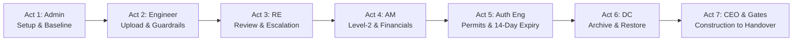

# CVTEC EDMS – Rapid MVP Presentation Workflow (Project 26002)

> **Document Path**: `docs/mvp-presentation-workflow.md`  
> **Target Audience**: Product Managers, Stakeholders, Evaluators, Engineering Leadership  
> **Reference Project**: **Project 26002** – Dubai Hills Commercial Pavilion (Master Authority: Nakheel & Trakhees)  
> **Reference Baseline**: [CVTEC_EDMS.md](file:///D:/giomj/Projects/engineer-docs-collab/CVTEC_EDMS.md) (Updated 14–15 Oct 2026)  
> **Simulated System Date**: **22 Oct 2026**

---

## 1. Executive Summary & Demo Objectives

This guide provides a rapid, high-impact **5-to-7 minute end-to-end presentation workflow** covering:

- **All 7 Canonical Roles** (`Admin`, `CEO`, `Area Manager`, `Resident Engineer`, `Authority Engineer`, `Engineer`, `Document Controller`).
- **All 3 Lifecycle Stages**: **Pre-Construction** $\rightarrow$ **Construction** $\rightarrow$ **Handover** (overcoming the Construction stage stoppage from Project 26001).
- **Nearest Realistic Dates** aligned directly with `CVTEC_EDMS.md` (Oct 14–22, 2026 kick-off, Oct 22 site commencement, Nov 2026 Handover, and a live 14-day statutory expiry alert for 04 Nov 2026).

---

## 2. Test Accounts & Quick Login Roster

All accounts share password `cvtec123`.

| Role                         | Canonical Email      | User Name                     | Focus in Demo                                                                |
| :--------------------------- | :------------------- | :---------------------------- | :--------------------------------------------------------------------------- |
| **Admin**                    | `admin@test.com`     | System Administrator          | Project registration, team staffing, sequence override with reason           |
| **Engineer**                 | `architect@test.com` | Liam Thorne                   | Upload `R00` drawing, view strict edit/delete block (inform DC)              |
| **Resident Engineer (RE)**   | `re@test.com`        | Resident Engineer Lead        | Level-1 review, direct approve `ready_for_authority`, or escalate to AM      |
| **Area Manager (AM)**        | `am3@test.com`       | Hassan Al-Maktoum             | Level-2 review of escalated drawing, audit confidential consultant fee       |
| **Authority Engineer**       | `ae3@test.com`       | Zayed Al-Hashimi              | Authority NOC submission, fee receipt, 14-day expiry radar                   |
| **Document Controller (DC)** | `dc@test.com`        | Principal Document Controller | Upload `R01`, archive obsolete drawing, 1-click restore from `/archive`      |
| **CEO**                      | `ceo@test.com`       | Chief Executive Officer       | Read-only executive dashboard, contractor vs consultant sums, zero-delay KPI |

---

## 3. Nearest Dates Baseline Schedule (Aligned with CVTEC_EDMS.md)

| Stage                | Milestone / Statutory Event           | Date            | Significance in MVP Demo                                                       |
| :------------------- | :------------------------------------ | :-------------- | :----------------------------------------------------------------------------- |
| **Pre-Construction** | Project Kick-off                      | **14 Oct 2026** | Matches Jaylene's baseline interview date in `CVTEC_EDMS.md`                   |
| **Pre-Construction** | Topographical Affection Survey        | **16 Oct 2026** | Satisfies `gate-topo` (`26002-TOPO-001`)                                       |
| **Pre-Construction** | Concept Master Plan Sign-Off          | **18 Oct 2026** | Satisfies `gate-concept` (milestone date)                                      |
| **Pre-Construction** | DEWA Substation & Load NOC            | **20 Oct 2026** | Satisfies `gate-dewa` (`DEWA-SUB-2026-081`, AED 12,000 paid)                   |
| **Pre-Construction** | RTA Right-of-Way Permit               | **21 Oct 2026** | Expiry: **04 Nov 2026** (13 days out $\rightarrow$ **Triggers 14-day alert!**) |
| **Pre-Construction** | Building Permit Issuance              | **22 Oct 2026** | Satisfies `gate-permit` (**Pre-Construction reaches 7/7 100%**)                |
| **Construction**     | Site Commencement (Mobilization)      | **22 Oct 2026** | **Today's date** – unlocks 1-click Advance to Construction                     |
| **Construction**     | Temporary Power & Dewatering NOC      | **24 Oct 2026** | Satisfies `gate-temp-power` in Construction stage                              |
| **Construction**     | Core & Superstructure Inspection      | **05 Nov 2026** | Satisfies `gate-superstructure`                                                |
| **Handover**         | MEP & Life Safety Commissioning       | **20 Nov 2026** | Handover milestone baseline                                                    |
| **Handover**         | Civil Defence (DCD) Final Inspection  | **25 Nov 2026** | Satisfies `gate-dcd`                                                           |
| **Handover**         | Building Completion Certificate (BCC) | **30 Nov 2026** | Satisfies `gate-bcc` (**100% Handover Gate Completion**)                       |

---

## 4. Rapid 7-Act Presentation Script (5 to 7 Minutes)



### Act 1: Admin – Project Setup & Milestone Baseline (60 Seconds)

1. **Login**: `admin@test.com` $\rightarrow$ Navigate to `/projects`.
2. **Select Project**: Click **26002** (_Dubai Hills Commercial Pavilion_).
3. **Show Team Roster**: Click **Project Team** dialog. Show all 8 engineering and oversight roles assigned.
4. **Inspect Milestone Baseline**: Open `/noc-tracker`, select **26002**, click **Inspect Gate Checklist**.
5. **Demonstrate Stage Gate Engine**:
   - Point out Pre-Construction Gate: **7 of 7 Satisfied (100%)**.
   - Show Green Button **Advance to Construction** is unlocked and ready.

---

### Act 2: Discipline Engineer – Drawing Upload & Role Guardrails (45 Seconds)

1. **Login**: `architect@test.com` (Liam Thorne – Architectural Engineer).
2. **Navigate**: `/documents`. Notice Liam only sees assigned projects (`26001`, `26002`).
3. **Upload Drawing**: Click **+ Upload Document**:
   - Sheet: `26002-ARC-201`, Title: `Pavilion Ground Floor Architecture & Elevation Layout`.
   - File: Attach sample CAD/PDF $\rightarrow$ Click **Upload & Submit**. Status marks `submitted`.
4. **Demonstrate Guardrail**: Point out that Liam **cannot edit or delete** uploaded drawings (per Jaylene rule #3 in `CVTEC_EDMS.md`: _Engineers cannot edit or replace own uploads; adjustments require Document Controller_).

---

### Act 3: Resident Engineer – First-Level Review & Two-Tier Escalation (60 Seconds)

1. **Login**: `re@test.com` (Resident Engineer Lead).
2. **Navigate**: `/review`. Notice pending drawings under Project `26002`:
   - `26002-ARC-201` (`submitted`)
   - `26002-STR-301` (`escalated`)
3. **Execute Review**: Click **Review** on `26002-ARC-201`:
   - Show 3 Review Options:
     - **Approve (Direct)** $\rightarrow$ Transitions status directly to `ready_for_authority`.
     - **Escalate to Area Manager** $\rightarrow$ Flags for Area Manager second-level sign-off.
     - **Reject + Comment** $\rightarrow$ Requires rejection comment, routes back to uploader for `R01`.
   - Click **Approve (Direct)**. Drawing instantly disappears from pending queue and marks `ready_for_authority`.

---

### Act 4: Area Manager – Technical Oversight & Financial Confidentiality (45 Seconds)

1. **Login**: `am3@test.com` (Hassan Al-Maktoum – Area Manager).
2. **Navigate**: `/review`.
3. **Approve Escalated Submittal**: Open `26002-STR-301` (Steel Canopy Details).
   - Enter managerial approval notes $\rightarrow$ Click **Approve**. Drawing advances to `ready_for_authority`.
4. **Inspect Financial Confidentiality**: Navigate to `/dashboard`:
   - Area Manager sees both **Contractor Contract Sum (AED 28,000,000)** AND **Confidential Consultant Fee (AED 2,100,000)**.
   - Point out that neither Resident Engineer nor Discipline Engineers have access to the consultant fee amount.

---

### Act 5: Authority Engineer – Statutory Permitting, Submissions & Expiry Lifecycle (60 Seconds)

1. **Login**: `ae3@test.com` (Zayed Al-Hashimi – Authority Engineer).
2. **Navigate**: `/noc-tracker` $\rightarrow$ Project `26002`.
3. **Statutory Submission & Checklist Gate**:
   - Open Sequence 1 (`DEWA Substation & Electrical Load NOC`).
   - Verify checklist items are satisfied (or show Admin waiver requirement if incomplete).
   - Click **Submit Application** $\rightarrow$ Enter authority tracking Ref: `DEWA-2026-002`, Date: `2026-10-22`.
   - Status updates cleanly to **Submitted** (`applied` on authority portal).
4. **Authority Determination & Resubmission Cycle**:
   - Demonstrate **Record Decision**:
     - **Approved / Obtained**: Requires future expiry date $\rightarrow$ sets status to **Approved** with certificate reference.
     - **Rejected / Comments**: Enter authority comments $\rightarrow$ transitions status to **Rejected**, archives rejection in audit trail, and increments revision (`R00` $\rightarrow$ `R01`).
     - **Resubmit Rejected Drawings**: In drawer, attach revised drawing package `DWG-26002-DCD-R01.pdf` $\rightarrow$ click **Confirm & Dispatch**. Submittal directly updates to **Submitted** under revision `R01`.
5. **Two-Tier Expiry Radar (Upcoming vs Lapsed)**:
   - **14-Day Amber Warning**: Look at Sequence 2 (`RTA Traffic Impact & Right-of-Way Permit`). Expiry is set to **04 Nov 2026** (13 days from today). Top ribbon highlights `Expiring in 14 Days`.
   - **Permit Expired Red Alert**: If an approved permit's expiry lapses past today, the system immediately flags a red `Permit Expired` alert button and unlocks **Resubmit for Revalidation (Expired Permit)**.
   - Explain how statutory alerts notify Authority Engineer, Document Controller, and CEO to prevent illegal work stoppages.

---

### Act 6: Document Controller – Revisions, Archive & 1-Click Restore (45 Seconds)

1. **Login**: `dc@test.com` (Principal Document Controller).
2. **Navigate**: `/documents`.
3. **Archive an Obsolete File**:
   - Locate `26002-ARC-099` (_Preliminary Concept Sketch_).
   - Click Action Menu $\rightarrow$ **Archive Document**. File safely unlists from active directory.
4. **1-Click Restore**:
   - Navigate to `/archive`.
   - Locate `26002-ARC-099` in the soft-deleted ledger.
   - Click **Restore**. Document immediately restores back to active documents with history intact.

---

### Act 7: Full Lifecycle Progression – Construction $\rightarrow$ Handover $\rightarrow$ CEO Audit (90 Seconds)

1. **Stage Advance to Construction**:
   - Open `/noc-tracker` as `admin@test.com` or `am3@test.com`.
   - Open `StageGateDrawer` for Project `26002`.
   - Click **Advance to Construction**.
   - Project lifecycle stage immediately updates to **Construction**!
   - Stepper highlights `Construction` active.
2. **Construction Gate Governance**:
   - Review Construction stage gates: Temporary Power NOC, Superstructure Inspection, MEP commissioning.
   - Click **Advance to Handover (Advisory Override)** or satisfy remaining inspection submittals.
   - Advance stage to **Handover**!
3. **Handover Stage & BCC Issuance**:
   - Handover gates display Civil Defence Clearance (`gate-dcd`) and Building Completion Certificate (`gate-bcc`).
   - Milestone `bccIssuanceDate` shows **30 Nov 2026** ready for occupancy handover.
4. **CEO Portfolio Health Audit**:
   - Switch user to `ceo@test.com`.
   - Navigate to `/dashboard`.
   - Verify CEO Read-Only isolation:
     - Full visibility into project progress across Pre-Construction, Construction, and Handover.
     - Portfolio margins: Contractor Sum (AED 28M) vs Consultant Margin (AED 2.1M).
     - Upcoming expiries radar shows the 13-day RTA permit.
     - **Zero edit, upload, or approve buttons visible** (tamper-proof executive governance).

---

## 5. Summary of Automated Verification Suites

The MVP testbed for Project 26002 has been verified with live database checks:

| Verification Suite                | Command                                          | Result             |
| :-------------------------------- | :----------------------------------------------- | :----------------- |
| **Project 26002 MVP Lifecycle**   | `npx tsx scripts/verify-26002-workflow.ts`       | **Passed (4/4)**   |
| **Foundation & 7 Role Matrix**    | `npx tsx scripts/verify-foundation-and-admin.ts` | **Passed (11/11)** |
| **Authority Engineer Permitting** | `npx tsx scripts/verify-authority-engineer.ts`   | **Passed (13/13)** |
| **Milestone DB Persistence**      | `npx tsx scripts/verify-db-milestones.ts`        | **Passed (4/4)**   |

---

## 6. Resetting Project 26002 for Repeated Demonstrations

To reset Project 26002 back to a fresh 100% Pre-Construction gate-ready state before any presentation, run:

```bash
npx tsx scripts/seed-26002-mvp.ts
```
