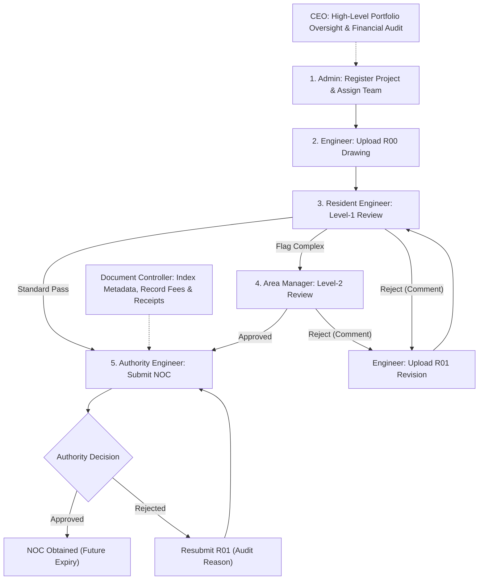
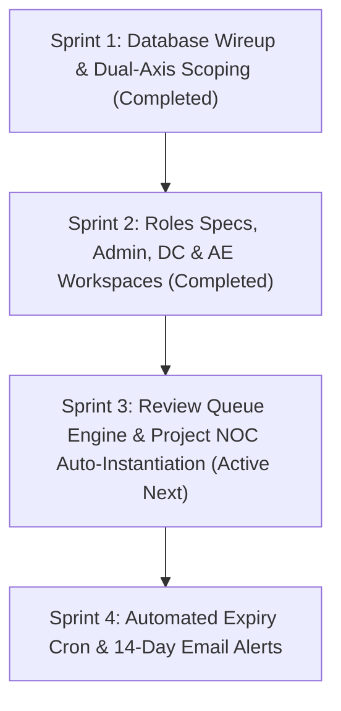

# Gap Analysis: Phase 1 Scope vs. CVTEC Business Brief & Current Implementation

## 1. Executive Verdict

**Current Status: Core Foundation, Role Taxonomy (7 Roles), NOC Matrix Template Subsystem, Project Registration, DC & AE Roles Completed; Review Queue Engine, NOC Auto-Instantiation & Expiry Cron Next**

Following the execution of the **Shared Foundation Migration**, **Role-Gated Security Definers**, **Document Controller (DC) Workspace**, and **Authority Engineer Pipeline**, the project stands at an advanced functional state with 100% pass rates across automated test suites:

1. **Scope-to-Business Alignment**:
   - **Resolved**: CVTEC's operational lifecycle is confirmed and migrated to **3 stages**: **Pre-Construction (Information and Design) → Construction → Handover** (consolidating Feasibility and Design per client directive).
   - **Resolved**: Complete 7-role specification suite established in `docs/specs/roles/` (`01-admin.md` through `07-ceo.md`) with shared foundation contracts in `00-foundation.md`.
   - **Resolved**: Canonical role taxonomy (`admin`, `ceo`, `area_manager`, `resident_engineer`, `authority_engineer`, `engineer`, `dc`) mapped with dual-layer enforcement (`lib/permissions.ts` + `private.has_role()`).
   - **Resolved**: Financial confidentiality split active in database: consultant fees isolated in `public.project_confidential` (restricted to Admin, CEO, and Area Manager).
   - **Resolved**: Master Authority NOC Matrix Subsystem (`/noc-matrix`) operational across Nakheel & Trakhees, Dubai Municipality, and Dubai Development Authority with strict adherence to the **Golden Propagation Rule**.
   - **Resolved**: Document Controller and Authority Engineer workflows verified via automated end-to-end suites (`verify-document-controller.ts`, `verify-authority-engineer.ts`).

2. **Immediate Implementation Focus**:
   - Repair review queue actions (`app/(app)/review/actions.ts`) to write to `public.document_reviews` and advance document status to `ready_for_authority` or `rejected`.
   - Implement project NOC template auto-instantiation and dynamic authority selection in `/projects/new`.
   - Implement project code auto-incrementer (`YY` + 3 digits, e.g. `26001`) from `project_code_counters`.
   - Implement automated daily expiry status flip (`pg_cron`) and 14-day alert email dispatcher (Resend).

---

## 2. Cross-Comparative Analysis

### A. CVTEC Business Reality (`BUSINESS_BRIEF_INFO.md`) vs. Phase 1 Scope

| Business Factor           | CVTEC Operational Profile                                                                               | Phase 1 Scope Specification                                                                                           | Current Implementation Assessment                                                                                                                                      |
| :------------------------ | :------------------------------------------------------------------------------------------------------ | :-------------------------------------------------------------------------------------------------------------------- | :--------------------------------------------------------------------------------------------------------------------------------------------------------------------- |
| **Three Specialist Arms** | 1. **CVTEC Archiplanners™** 2. **CVTEC EngiLab™** 3. **CVTEC Project™**                           | Covers 5 discipline roles (Authority, MEP, Architect, Structure, Civil). Excludes dedicated PM role in initial phase. | **Aligned**: 7-role system maps Area Manager and Resident Engineer to project oversight; engineering disciplines assigned per-project on `project_members.discipline`. |
| **Project Jurisdictions** | $4.2B landmark Dubai portfolio: Nakheel, Trakhees, DM, DDA. Waterfront and infrastructure developments. | Covers top Dubai statutory authorities: Nakheel & Trakhees, Dubai Municipality, Dubai Development Authority.          | **Aligned**: Standard authority matrix templates operational for all 3 master jurisdictions with atomic propagation.                                                   |
| **BIM Modeling Workflow** | Central federated models (LOD 300/400) integrating Arch, Struct, and MEP as single source of truth.     | Free-tier Supabase (50 MB limit); heavy BIM federation deferred to subsequent phases.                                 | **Partially Aligned**: Handles statutory 2D drawings and drawing PDFs. Deep CAD/BIM model federation deferred.                                                         |
| **Project Lifecycle**     | **Pre-Construction (Info & Design) → Construction → Handover**                                          | Tracks Design and Supervision contracts; Handover NOC stage included.                                                 | **Fully Aligned**: 3-stage lifecycle engine operational across NOC Tracker, Executive Dashboard, and Project Creation.                                                 |

---

### B. Phase 1 Scope vs. Current Codebase Implementation

| Feature / Deliverable                 | Phase 1 Scope Specification                                                                              | Current Codebase Implementation                                                                                                                                      | Status                    |
| :------------------------------------ | :------------------------------------------------------------------------------------------------------- | :------------------------------------------------------------------------------------------------------------------------------------------------------------------- | :------------------------ |
| **NOC Matrix Template Editor**        | Editor for Authority Engineer and DC; cascade changes to unobtained NOCs without mutating approved NOCs. | `/noc-matrix` workspace with dynamic checklist builder, acyclic prerequisite picker, revision timeline, and atomic RPC propagation (`propagate_matrix_item_change`). | **Completed & Verified**  |
| **Prerequisite Blocking Sequence**    | Applied status blocked until prerequisite NOC approved; Admin can override with logged reason.           | Visual lock badges; `NocInspectorDrawer` enforces gates; role-gated Admin sequence override modal with mandatory justification (>= 15 chars).                        | **Completed & Verified**  |
| **NOC Fee & Receipt Tracking**        | Track fee amount, payer (`Client`, `Contractor`, `Consultant Advance`), paid toggle, receipt link.       | `NocInspectorDrawer` and `app/actions/noc.ts` (`recordNocFeePayment`) record fee, payer, receipt number, and receipt reference link.                                 | **Completed & Verified**  |
| **Resubmission Audit History**        | Rejected NOC resubmission (`R00` → `R01`) keeps prior rejection reasons and dates.                       | Resubmission workflow retains prior rejection comments, advances revision tag, logs to `noc_resubmission_history`, and displays historical accordion.                | **Completed & Verified**  |
| **3-Stage Project Lifecycle & Gates** | Pre-Construction, Construction, Handover with milestone tracking and prerequisite checklists.            | 3-stage sequential stepper and slide-over stage gate inspector with role-gated advance logic across NOC Tracker and Executive Dashboard.                             | **Completed & Verified**  |
| **Dual-Axis Project Scoping (RLS)**   | Engineers and DCs view assigned projects only; Admin, CEO, Area Manager see all.                         | Enforced in database via `private.can_see_project(project_id)` and in server queries via `lib/server/noc-data.ts`.                                                   | **Completed & Verified**  |
| **Project Setup Workspace**           | Register new project, assign authority template, generate code, configure team members.                  | `/projects/new` created with `ProjectRegistrationForm` and `app/actions/admin.ts: createProject`. Template NOC instantiation and auto-counter pending.               | **In Progress (Partial)** |
| **Two-Tier Drawing Review**           | RE performs Level-1 review (approve, escalate, reject); AM performs Level-2 review.                      | `/review` workspace with `ReviewQueueTable`, `DrawingReviewModal`, `submitResidentEngineerReview`, and `submitAreaManagerReview` updating `documents.status` and logging to `document_reviews` and `audit_log`. | **Completed & Verified**  |
| **Automated Expiry & 14-Day Alerts**  | Auto-flip to `Expired` on expiry date; email DC and Authority Engineer 14 days prior.                    | UI badge and KPI table identify upcoming expiries. Automated server cron (`pg_cron`) and email dispatcher (Resend) pending.                                          | **Pending**               |
| **External Stakeholder Alerts**       | Email client and contractor on `noc.obtained`, `noc.expiring`, `noc.rejected` (no login).                | Stakeholder contact emails captured on `projects`; event taxonomy defined in `lib/permissions.ts`. Delivery worker pending.                                          | **Pending**               |

---

## 3. Four-Tier Scope Status Breakdown

### Tier 1: Database Schema & Supabase Architecture

- [x] **`noc_matrix_items` Table**: Sequence numbers, blocking sequence, validity days, default fees, RLS policies.
- [x] **`noc_matrix_requirements` Table**: Deliverable checklists per matrix template item.
- [x] **`noc_matrix_revisions` Table**: Immutable audit log of template edits with propagation metrics.
- [x] **`project_nocs` Table Augmentation**: Enhanced with fees, payer types, receipts, blocking sequence, revisions, and override reasons.
- [x] **`noc_resubmission_history` Table**: Stores rejection reasons, timestamps, and revision tracking.
- [x] **`project_noc_requirements` Table**: Project checklist items with toggle states and attachment links.
- [x] **`project_confidential` Table**: Isolates consultant fee sums with strict RLS for Admin, CEO, and Area Manager.
- [x] **`audit_log` Table**: Central governance audit log with Admin-exclusive read access.
- [x] **`private` Schema Security Definers**: `private.has_role()` and `private.can_see_project()` preventing RLS recursion.
- [x] **Document Controller RLS Migration**: `20261015000000_dc_role_rls.sql` executed and verified.
- [x] **Authority Engineer RLS Migration**: `20261015010000_authority_engineer_role_rls.sql` executed and verified.
- [x] **Resident Engineer & Area Manager RLS Migration**: `20261016000000_resident_engineer_role_rls.sql` and `20261016010000_area_manager_role_rls.sql` executed and verified.

---

### Tier 2: Backend Automation & Business Logic

- [x] **Atomic Template Propagation Engine**: Stored procedure `propagate_matrix_item_change` cascading changes to unobtained NOCs while preserving approved NOCs.
- [x] **Admin Governance Actions**: User invitation, role modification, self-demotion guards, project registration, permanent purge in `app/actions/admin.ts`.
- [x] **Document Controller Actions**: Document upload (R00), metadata editing, revision increment (R01), soft-delete archive, archive restore in `app/actions/documents.ts`.
- [x] **Authority Engineer Actions**: Statutory application submission, authority approval with future expiry validation, rejection logging in `app/actions/noc.ts`.
- [x] **Two-Tier Review Server Actions**: `submitResidentEngineerReview` and `submitAreaManagerReview` write to `document_reviews`, update `documents.status`, log to `audit_log`, and rollback status on error.
- [ ] **Project Template NOC Instantiator**: Batch-copy `noc_matrix_items` into `project_nocs` when registering a new project in `createProject`.
- [ ] **Project Code Auto-Incrementer**: Query and increment `project_code_counters` to generate `YY` + `NNN` (e.g. `26001`).
- [ ] **Automated Expiry Cron Job**: Daily job at 00:00 GST setting status to `Expired` when `expiry_date <= CURRENT_DATE`.
- [ ] **14-Day Alert Email Dispatcher**: Automated notification worker delivering email alerts to assigned DC and Authority Engineer.
- [ ] **External Stakeholder Email Worker**: Dispatch email updates to client and contractor email lists on NOC events.

---

### Tier 3: UI & Workspace Enhancements

- [x] **Authority NOC Matrix Workspace (`/noc-matrix`)**: Authority tab switcher, stage grouping, sequence display, drawer triggers.
- [x] **Matrix Item Editor Drawer (`MatrixItemEditorDrawer`)**: 480px slide-over with dynamic checklist builder, acyclic prerequisite picker, fee/validity inputs, mandatory justification.
- [x] **Matrix Revision Drawer (`MatrixRevisionDrawer`)**: Chronological audit timeline with author credentials, justification card, and propagation impact metrics.
- [x] **Inspection Drawer (`NocInspectorDrawer`)**: Downstream fee payer selector, receipt reference, resubmission accordion, sequence override modal.
- [x] **Document Management Workspace (`/documents`)**: High-density table with discipline filter, revision badges, download URLs, edit/revision modals, and `ready_for_authority` filter.
- [x] **Document Archive (`/archive`)**: Soft-delete archive with project scoping, restore confirmation, and role-gated permanent purge dialog.
- [x] **Project Setup Form (`/projects/new`)**: Admin form for project metadata, client/contractor contacts, and contract amounts.
- [x] **Review Queue Workspace (`/review`)**: High-density `ReviewQueueTable` and `DrawingReviewModal` with RE Direct Approve, RE Escalate to Area Manager, AM Direct Approve, and Reject with mandatory feedback.
- [ ] **Project Setup Improvements**: Add authority template dropdown and auto-generate code button in `ProjectRegistrationForm`.

---

### Tier 4: CVTEC Operations & Role Alignment

- [x] **3-Stage Lifecycle Engine**: Pre-Construction, Construction, Handover stepper and stage-gate readiness inspectors across NOC Tracker and Dashboard.
- [x] **Specialist Disciplines**: Drawer and status engine covering Geotechnical, Marine, Topographical, Traffic Impact, and Green Building.
- [x] **Statutory Jurisdiction Alignment**: Specific coverage of Nakheel/Trakhees, Dubai Municipality, and Dubai Development Authority.
- [x] **Financial Confidentiality**: Consultant fees hidden from DC, Engineer, RE, and Authority Engineer; visible to Admin, CEO, and Area Manager.
- [ ] **Enforce Engineer Discipline Restriction**: Restrict drawing upload discipline to match user's assigned discipline on `project_members.discipline`.
- [ ] **BIM Model Coordination Metadata**: Add BIM Model Version and LOD 300/400 sign-off status to drawing revision records.

---

## 4. Critical Break Points & System Vulnerabilities

The following architectural and runtime points are vulnerable to failure and require immediate remediation:

### 1. The Review Queue Disconnect [RESOLVED]

- **Resolution**: `submitResidentEngineerReview` and `submitAreaManagerReview` write directly to `public.document_reviews`, mutate `public.documents.status` (`ready_for_authority`, `escalated`, `rejected`), rollback status upon audit insertion failure, and log governance records to `public.audit_log`.
- **Status**: Completed and verified via automated test suites `verify-resident-engineer.ts` and `verify-area-manager.ts`.

### 2. New Project Empty NOC Tracker (`app/actions/admin.ts: createProject`)

- **Problem**: Previously, `createProject` inserted a project without instantiating `project_nocs` or checklist requirements from `noc_matrix_items`.
- **Resolution**: `createProject` in `app/actions/admin.ts` now automatically queries `noc_matrix_items` for the selected `master_authority_id`, cloning all statutory NOCs into `public.project_nocs` and associated deliverable checklists into `public.project_noc_requirements`. Supports fallback to `SEED_MATRIX_TEMPLATES` for unseeded master authorities (e.g. Dubai Municipality), rolls back project creation upon fatal configuration errors, logs `instantiated_nocs_count` to `public.audit_log`, and revalidates `/projects`, `/noc-tracker`, `/noc`, and `/dashboard`.
- **Status**: Completed and verified via end-to-end database instantiation test and full test suite regression pass.

### 3. Mock Fallback Mutation Blackhole (`lib/server/noc-data.ts` & `app/actions/noc.ts`)

- **Problem**: When a project has no database NOC rows, `lib/server/noc-data.ts` falls back to `SEED_PROJECTS` (hardcoded 23015/23016 with IDs like `noc-1`).
- **Break Point**: In `app/actions/noc.ts`, mutations validate if `nocId` is a UUID. If not, they return `{ success: true }` without executing any database update.
- **Impact**: Users interact with mock records, receive success toast notifications, but changes are discarded silently on page reload.

### 4. Unenforced Discipline Scope on Document Upload

- **Problem**: `uploadDocument` in `app/actions/documents.ts` accepts any discipline from the client form (`mep`, `architect`, `structure`, `civil`).
- **Break Point**: The server action does not verify that the user's `project_members.discipline` matches the uploaded drawing's discipline.
- **Impact**: An MEP engineer can upload structural or civil drawings, violating discipline ownership boundaries.

### 5. Absence of Background Expiry Engine

- **Problem**: Expiration is calculated on-the-fly in the UI based on `expiry_date < today`.
- **Break Point**: No backend process (`pg_cron` or Edge Function) mutates `status_code` to `'expired'` in `project_nocs`.
- **Impact**: Database queries filtering by `status_code = 'expired'` return zero rows. External webhook triggers and reporting metrics based on stored status fail.

---

## 5. Areas Needing Improvement & Technical Debt

1. **Review Queue Multi-Tier Wiring**:
   - Update `app/(app)/review/page.tsx` and `review-dialog.tsx` to handle RE first-level review (Direct Approve, Escalate to AM, Reject) and AM second-level review (Approve, Reject).
   - Write review records to `public.document_reviews` and update `public.documents.status`.
2. **Project Setup Automation**:
   - Provide Master Authority selection dropdown on `/projects/new`.
   - On submission, trigger atomic batch insertion of corresponding `noc_matrix_items` into `project_nocs`.
   - Implement automatic project code generator (`YY` + 3-digit counter).
3. **Automated Alerts & Cron Dispatcher**:
   - Deploy Supabase scheduled cron (`pg_cron`) running nightly at 00:00 GST.
   - Wire Resend API to deliver 14-day expiry warning emails to assigned Document Controllers and Authority Engineers.
   - Dispatch event emails (`noc.obtained`, `noc.expiring`, `noc.rejected`) to client and contractor email lists.
4. **Storage Bucket Hardening**:
   - Ensure Supabase Storage buckets `documents`, `receipts`, and `submissions` have strict row-level security policies restricting access to assigned project members.

---

## 6. Standard User Workflows (If Followed Correctly)

The complete end-to-end operational workflows across all seven system roles:

### 1. Admin Workflow (`/projects/new`, `/users`, `/archive`)

1. **User Management**: Navigates to `/users`, clicks **Invite User**, enters email, name, and assigns canonical role.
2. **Project Initialization**: Navigates to `/projects/new`, selects Master Authority (e.g. Nakheel & Trakhees), enters project code, name, client/contractor contact emails, and contract values (contractor sum and confidential consultant sum).
3. **Team Assignment**: Assigns discipline engineers (MEP, Architect, Structure, Civil), Resident Engineer, Authority Engineer, and Document Controller.
4. **Sequence Overrides**: If statutory sequencing requires exception handling, opens NOC Tracker, triggers **Admin Sequence Override**, inputs mandatory justification (>= 15 characters), and unblocks submission.
5. **Permanent Purge**: Navigates to `/archive` to inspect soft-deleted documents; executes permanent purge only after typing confirmation phrase.

### 2. Engineer Workflow (`/documents`, `/dashboard`)

1. **Project Navigation**: Logs in, views assigned projects on Dashboard.
2. **Drawing Upload (R00)**: Navigates to `/documents`, clicks **Upload Drawing**, selects assigned project and discipline, attaches PDF/DWG file, enters sheet number and title. File is uploaded as `R00` with status `submitted`.
3. **Review Monitoring**: Monitors review status via high-contrast badges: `submitted` (Under Review - RE) or `escalated` (Under Review - AM).
4. **Handling Rejections**: If rejected, inspects reviewer's comment in `RejectionFeedbackCard`, resolves comments in CAD/BIM, clicks **Upload Revision**, and submits `R01`. Status resets to `submitted`.

### 3. Resident Engineer (RE) Workflow (`/review`)

1. **Queue Inspection**: Navigates to `/review`, sees drawings with status `submitted` across assigned projects.
2. **Technical Review**: Opens drawing in viewer, inspects sheet specifications against compliance standards.
3. **Decision Execution**:
   - **Standard Approval**: Clicks **Approve (Direct)**; drawing status transitions to `ready_for_authority`.
   - **Escalation**: Flags complex or high-risk design items; clicks **Escalate to Area Manager**; status transitions to `escalated`.
   - **Rejection**: Enters mandatory technical feedback describing deficiency; clicks **Reject**; status transitions to `rejected`.

### 4. Area Manager (AM) Workflow (`/review`, `/dashboard`, `/noc-tracker`)

1. **Level-2 Review**: Navigates to `/review`, filters for drawings marked `escalated` or unassigned project drawings (RE absent).
2. **Determination**: Evaluates design rationale and RE notes; approves (`ready_for_authority`) or rejects with mandatory feedback (`rejected`).
3. **Portfolio Oversight**: Reviews Dashboard across all projects (`project.viewAll`), auditing contractor amounts, confidential consultant amounts, milestone progress, and delay KPIs.
4. **NOC Oversight**: Inspects `/noc-tracker` in read-only mode to monitor statutory bottlenecks.

### 5. Document Controller (DC) Workflow (`/documents`, `/archive`, `/noc-tracker`, `/noc-matrix`)

1. **Drawing Library Maintenance**: Navigates to `/documents`, reviews metadata, updates drawing indexing, and uploads new revisions on behalf of team members.
2. **Archive Management**: Soft-deletes superseded or obsolete files (`document.archive`); navigates to `/archive` to restore erroneously archived files.
3. **NOC Fee Tracking**: Opens `/noc-tracker`, clicks NOC item, enters authority fee amount, selects fee payer (`Client`, `Contractor`, `Consultant Advance`), toggles paid status, and records receipt reference link.
4. **Matrix Maintenance**: Navigates to `/noc-matrix`, proposes template adjustments with mandatory justification; propagation cascades to unobtained project NOCs.

### 6. Authority Engineer Workflow (`/noc-tracker`, `/documents`, `/noc-matrix`)

1. **Package Preparation**: Navigates to `/documents`, filters by `ready_for_authority` to retrieve approved technical drawings for submission.
2. **Prerequisite Verification**: Opens `/noc-tracker`, checks prerequisite sequence status. If blocked, coordinates with team or requests Admin override.
3. **Application Submission**: Clicks **Submit Application**, enters authority submission reference number, submission date, and uploads submission proof slip. Status updates to `submitted`.
4. **Recording Authority Decision**:
   - **Obtained**: Clicks **Record Decision** -> **Approved**, enters mandatory future expiry date, attaches permit document. Status updates to `obtained`.
   - **Rejected**: Clicks **Record Decision** -> **Rejected**, enters authority rejection reason (>= 5 characters). Revision advances (`R00` -> `R01`), rejection history is logged, and status updates to `rejected`.

### 7. Chief Executive Officer (CEO) Workflow (`/dashboard`, `/noc-tracker`, `/documents`)

1. **Command Deck Oversight**: Logs in, reviews Executive KPI ribbon (active projects, clearance rate, critical delays, upcoming expiries, review backlog).
2. **Financial Portfolio Audit**: Audits total contractor and confidential consultant contract sums across all active projects.
3. **Permitting Progress Tracking**: Monitors 3-stage lifecycle progress and NOC clearance percentages.
4. **Read-Only Security**: Retains full visibility without mutation capabilities (zero edit, upload, or approval buttons rendered).

---

## 7. Roadmap & Priority Implementation Sprints

### Next Immediate Sprints

1. **Sprint 3 (Review Queue Engine & Project NOC Auto-Instantiation) - IMMEDIATE PRIORITY**:
   - Update `app/(app)/review/actions.ts` to write to `public.document_reviews` and update `documents.status` (`ready_for_authority`, `escalated`, `rejected`).
   - Upgrade `/review` UI to support RE Level-1 options (Approve, Escalate, Reject) and AM Level-2 options.
   - Update `createProject` in `app/actions/admin.ts` to dynamically accept `master_authority_id` and batch-insert `noc_matrix_items` into `project_nocs`.
   - Implement project code auto-counter in `/projects/new`.
   - Enforce discipline match validation in `app/actions/documents.ts: uploadDocument`.

2. **Sprint 4 (Automated Alerts & Expiration Scheduler)**:
   - Configure Supabase `pg_cron` job running nightly at 00:00 GST to flip `status_code = 'expired'` when `expiry_date <= CURRENT_DATE`.
   - Integrate Resend API email dispatcher to notify assigned DC and Authority Engineer 14 days prior to NOC expiry.
   - Dispatch automated event emails to client and contractor email lists on NOC approval, expiry, and rejection.
