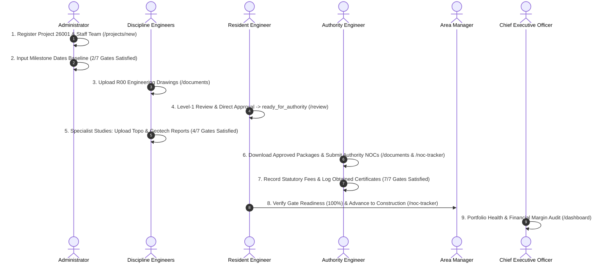

# CVTEC EDMS – End-to-End Project Lifecycle & Multi-Role Operational Workflow

> **Document Path**: `docs/project-lifecycle-workflow.md`  
> **Applicable Version**: CVTEC EDMS 1.0  
> **Target Audience**: Administrators, Project Engineers, Resident Engineers, Area Managers, Authority Engineers, Document Controllers, Executive Leadership  
> **Reference Project**: Project 26001 – Al Wasl Residential Tower Phase 2 (Master Authority: Nakheel & Partners)

---

## 1. Executive Summary & Architecture Overview

The CVTEC Engineering Document Management System (EDMS) enforces an automated governance and quality gatekeeper engine between project lifecycle stages:

- **Pre-Construction** (Information & Design)
- **Construction** (Site Execution & Supervision)
- **Handover** (Testing, Commissioning & Occupancy)

Transitions between stages require satisfying verified engineering studies, statutory authority Non-Objection Certificates (NOCs), and contractual milestone schedules before physical site work begins.

This guide provides the complete end-to-end multi-role operational workflow, from initial project registration by the Administrator through drawing production, technical reviews, statutory permitting, and formal stage advancement into Construction.

---

## 2. High-Level Lifecycle Interaction Diagram

---

## 3. Pre-Construction Stage Gate Readiness Engine

When a project is created in `Pre-Construction`, the system provisions **7 mandatory Gate Prerequisites** across 3 categories:

| Gate ID        | Prerequisite Title                              | Category               | Technical Requirement                                      | Satisfaction Trigger                                    |
| -------------- | ----------------------------------------------- | ---------------------- | ---------------------------------------------------------- | ------------------------------------------------------- |
| `gate-topo`    | **Topographical Affection Survey Completed**    | `specialist_study`     | Boundary coordinates, ground elevations, benchmark points. | Specialist study marked `Uploaded` or `Approved`.       |
| `gate-geotech` | **Geotechnical Soil Investigation Approved**    | `specialist_study`     | Soil bearing capacity and borehole drilling reports.       | Geotechnical specialist study marked `Approved`.        |
| `gate-concept` | **Concept Master Plan & Affection Sign-Off**    | `regulatory_milestone` | Client and Master Developer concept design approval.       | `conceptApprovalDate` set in Milestone Dates Reference. |
| `gate-dewa`    | **DEWA Substation & Electrical Load NOC**       | `authority_noc`        | Substation room allocation and load sanction.              | DEWA Design/Information NOC marked `Approved`.          |
| `gate-rta`     | **RTA Traffic Impact & Right-of-Way Permit**    | `authority_noc`        | Site access, road tie-ins, and traffic impact sign-off.    | RTA NOC marked `Approved`.                              |
| `gate-struct`  | **Master Authority Structural Engineering NOC** | `authority_noc`        | Structural calculations and foundation design permit.      | Master Authority Structural NOC marked `Approved`.      |
| `gate-permit`  | **Official Building Permit Issuance**           | `regulatory_milestone` | Municipality or Master Developer site mobilization permit. | `buildingPermitDate` set in Milestone Dates Reference.  |

### Live Gate Readiness Formula

$$\text{Readiness Percentage} = \left(\frac{\text{Satisfied Gate Prerequisites}}{7}\right) \times 100$$

- **0 of 7 Satisfied (0%)**: Fresh project initialization baseline.
- **2 of 7 Satisfied (29%)**: Milestone dates entered (Concept Approval + Building Permit).
- **4 of 7 Satisfied (57%)**: Specialist Topo & Geotechnical reports uploaded and approved.
- **7 of 7 Satisfied (100%)**: Statutory authority permits obtained. Gate transition unlocks.

---

## 4. End-to-End Role-by-Role Workflow

### Step 1: Project Registration & Milestone Baseline Setup

- **Actor**: Administrator (`admin@cvtec.com`)
- **Workspaces**: `/projects/new`, `/noc-tracker`, `StageGateDrawer`
- **Actions**:
  1. Navigate to `/projects/new` and input project details:
     - Project Code: `26001` (5 numeric digits per `projects_code_check`).
     - Project Title: `Al Wasl Residential Tower Phase 2`.
     - Master Authority: `Nakheel & Partners`.
     - Initial Stage: `Pre-Construction`.
     - Financials: Contractor Sum (AED 45,000,000) and Confidential Consultant Fee (AED 3,200,000).
  2. In **Phase 2: Consultant Staffing**, assign project team leads:
     - Authority Engineer: `Sayed Al-Hashemi`
     - Architectural Lead: `Liam Thorne`
     - MEP Lead: `Sunita Sharma`
     - Civil Lead: `Abbas Al-Ayachi`
     - Resident Engineer: `Resident Engineer Lead`
     - Area Manager: `Hassan Al-Maktoum`
  3. Navigate to `/noc-tracker`, select Project `26001`, and click **Inspect Gate Checklist**.
  4. In `StageGateDrawer`, under **Milestone Dates Reference**, click **Edit Dates** and enter:
     - Kick-off Date: `21 Oct 2026`
     - Topographical Survey Date: `21 Oct 2026`
     - Concept Approval Date: `21 Oct 2026`
     - Design Commencement Date: `21 Oct 2026`
     - Planned Completion Date: `21 Oct 2026`
     - Building Permit Issuance Date: `21 Oct 2026`
     - Construction Target Milestones: Site Commencement, Target Substantial Completion, Extension of Time (EOT).
  5. Click **Save Milestone Dates**.
- **System Outcome**:
  - `gate-concept` and `gate-permit` immediately update to `Satisfied`.
  - Gate Progress updates to **2 of 7 Satisfied (29%)**.

---

### Step 2: Technical Drawing Production & Specialist Studies Upload

- **Actors**: Discipline Engineers (`Liam Thorne`, `Sunita Sharma`, `Abbas Al-Ayachi`)
- **Workspace**: `/documents`
- **Actions**:
  1. **MEP Lead (`Sunita Sharma`)**:
     - Clicks **+ Upload Document** in `DocumentUploadModal`.
     - Selects Project `26001`, Discipline `MEP`, Sheet Number `MEP-E-101`, Title `Substation & Main Electrical Incomer Layout`.
     - Attaches drawing file (PDF/DWG) and clicks **Upload & Submit**.
     - Initial revision `R00` registers with status `submitted`.
  2. **Architectural Lead (`Liam Thorne`)**:
     - Uploads `ARC-P-001` (`Master Concept Plan & Elevations`, Revision `R00`).
     - Status updates to `submitted`.
  3. **Civil & Specialist Lead (`Abbas Al-Ayachi`)**:
     - Accesses third-party specialist drawer.
     - Uploads `Topographical Affection Survey` CAD file and coordinates report (`Uploaded`).
     - Uploads `Geotechnical Soil Investigation` borehole analysis report (`Approved`).
- **System Outcome**:
  - Drawings enter Resident Engineer's review queue at `/review`.
  - `gate-topo` satisfies upon survey upload.
  - `gate-geotech` satisfies upon geotechnical approval.
  - Gate Progress advances to **4 of 7 Satisfied (57%)**.

---

### Step 3: First-Level Technical Review & Direct Approval

- **Actor**: Resident Engineer (`Resident Engineer Lead`)
- **Workspace**: `/review`
- **Actions**:
  1. Opens review queue on `/review` and filters for Project `26001`.
  2. Identifies pending submittals: `MEP-E-101` and `ARC-P-001`.
  3. Clicks **Review** on `MEP-E-101` to launch `DrawingReviewModal`:
     - Inspects CAD/PDF file for code compliance, cable sizing, and transformer room clearance.
     - Clicks **Approve (Direct)**.
  4. Clicks **Review** on `ARC-P-001`:
     - Inspects setback lines, building heights, and affection coordinates.
     - Clicks **Approve (Direct)**.
- **System Outcome**:
  - Both drawings update status to `ready_for_authority`.
  - Audit log records approval timestamp and reviewer credentials.
  - Drawings become available in the Authority Engineer's submission bundle.

---

### Step 4: Statutory Authority Submissions & Permit Clearing

- **Actor**: Authority Engineer (`Sayed Al-Hashemi`)
- **Workspaces**: `/documents`, `/noc-tracker`
- **Actions**:
  1. Opens `/documents` and filters by status `ready_for_authority`.
  2. Downloads approved drawing packages `MEP-E-101` and `ARC-P-001`.
  3. Opens `/noc-tracker` for Project `26001`:
     - **DEWA Substation & Electrical Load NOC**:
       - Clicks item to open `NocInspectorDrawer`.
       - Logs submission reference (`DEWA-E-2026-9041`), sets submission date, attaches portal slip.
       - Records fee payment: AED 15,000 paid by Contractor (Receipt `RCP-9012`).
       - Upon authority sign-off, records authority result as `Approved / Obtained`, uploads stamped certificate, and inputs expiry date.
     - **RTA Traffic Impact & Right-of-Way Permit**:
       - Logs application reference (`RTA-TIS-2026-004`), records fee payment, attaches approved permit.
     - **Master Authority Structural Engineering NOC**:
       - Logs Nakheel/Trakhees structural submission, attaches calculation package, logs final stamped permit.
- **System Outcome**:
  - `gate-dewa`, `gate-rta`, and `gate-struct` transition to `Satisfied`.
  - Automated 14-day expiry monitor schedules notification emails for Sayed and Document Controller.
  - Gate Progress reaches **7 of 7 Satisfied (100%)**.

---

### Step 5: Lifecycle Stage Transition to Construction

- **Actors**: Resident Engineer (`Resident Engineer Lead`) or Area Manager (`Hassan Al-Maktoum`)
- **Workspace**: `/noc-tracker` → `StageGateDrawer`
- **Actions**:
  1. Opens `StageGateDrawer` for Project `26001`.
  2. Reviews checklist: All 7 prerequisites show green `Satisfied` badges.
  3. Amber advisory warning clears automatically.
  4. Green action button **Advance to Construction** unlocks.
  5. Clicks **Advance to Construction**.
- **System Outcome**:
  - `public.projects.lifecycle_stage` updates from `Pre-Construction` to `Construction`.
  - Stepper updates to indicate Construction stage active.
  - Pre-Construction gate checklist closes.
  - Construction stage gate prerequisites initialize:
    - Site Temporary Power & Dewatering NOC (`gate-temp-power`)
    - Core & Structural Superstructure Inspection (`gate-superstructure`)
    - MEP Riser & Chilled Water Commissioning Sign-off (`gate-mep-submittal`)
  - Target construction completion milestone dates activate.

---

### Step 6: Strategic Executive Monitoring & Portfolio Audit

- **Actor**: Chief Executive Officer (`ceo`)
- **Workspace**: `/dashboard`
- **Actions**:
  1. Reviews executive KPI ribbon:
     - Active Projects in Construction increments.
     - Review queue backlog reflects zero delays.
     - Upcoming expiries panel tracks 14-day permit horizons.
  2. Inspects `FinancialPortfolioWidget`:
     - Reviews Contractor Contract Sum (AED 45,000,000).
     - Audits Confidential Consultant Sum (AED 3,200,000) and consultancy margin.
  3. Validates read-only safeguards: Mutation and override controls remain hidden.

---

## 5. Master Role Permissions & Operational Boundary Matrix

| Capability / Action               |     Admin     |     CEO      | Area Manager | Resident Engineer | Authority Engineer |   Engineer    | Document Controller |
| --------------------------------- | :-----------: | :----------: | :----------: | :---------------: | :----------------: | :-----------: | :-----------------: |
| **Project Visibility**            | Global (All)  | Global (All) | Global (All) |   Assigned Only   |   Assigned Only    | Assigned Only |    Assigned Only    |
| **Initial Upload (`R00`)**        |       ✓       |      —       |      —       |         —         |      ✓ (Own)       |       ✓       |          ✓          |
| **Revision Upload (`R01+`)**      |       ✓       |      —       |      —       |         —         |      ✓ (Own)       | ✓ (On Reject) |          ✓          |
| **Drawing Review (Level 1)**      |       ✓       |      —       | ✓ (Fallback) |    ✓ (Primary)    |         —          |       —       |          —          |
| **Drawing Review (Level 2)**      |       ✓       |      —       | ✓ (Primary)  |         —         |         —          |       —       |          —          |
| **NOC Tracker Updates & Fees**    |       ✓       |      —       |      —       |         —         |         ✓          |       —       |          ✓          |
| **NOC Matrix Blueprint Edit**     |       ✓       |      —       |      —       |         —         |         ✓          |       —       |          ✓          |
| **NOC Sequence Override**         | ✓ (Exclusive) |      —       |      —       |         —         |         —          |       —       |          —          |
| **Advance Lifecycle Stage**       |       ✓       |      —       |      ✓       |         ✓         |         —          |       —       |          —          |
| **Advisory Stage Override**       |       ✓       |      —       |      ✓       |         ✓         |         —          |       —       |          —          |
| **Milestone Dates Edit**          |       ✓       |      —       |      ✓       |         ✓         |         —          |       —       |          —          |
| **Contractor Amount (Public)**    |       ✓       |      ✓       |      ✓       |         ✓         |         ✓          |       ✓       |          ✓          |
| **Consultant Sum (Confidential)** |       ✓       |      ✓       |      ✓       |    — (Hidden)     |     — (Hidden)     |  — (Hidden)   |     — (Hidden)      |
| **User Administration**           | ✓ (Exclusive) |      —       |      —       |         —         |         —          |       —       |          —          |
| **Permanent File Purge**          | ✓ (Exclusive) |      —       |      —       |         —         |         —          |       —       |          —          |

---

## 6. Exception & Governance Controls

### 1. Managerial Advisory Override

If site mobilization must proceed before all 7 gates are satisfied:

- Only `admin`, `area_manager`, and `resident_engineer` can trigger **Advance to Construction (Advisory Override)**.
- Unauthorized roles (`engineer`, `dc`, `authority_engineer`) see locked state.
- System records warning banner and logs managerial liability event to `audit_log`.

### 2. Statutory NOC Sequence Dependency Override

If an authority requires an NOC out of order (e.g., fast-tracked under statutory waiver):

- Only `admin` can execute sequence overrides in `NocInspectorDrawer`.
- Requires mandatory written justification (minimum 15 characters).
- Sequence lock bypass and audit justification are permanently archived.

### 3. Financial Confidentiality Separation

- `client_contractor_amount` stored in `public.projects` (visible to project team).
- `client_consultant_amount` stored in `public.project_confidential` (RLS protected, accessible exclusively to `admin`, `ceo`, and `area_manager`).
- Confidential sums are completely excluded from API payloads for other roles.
